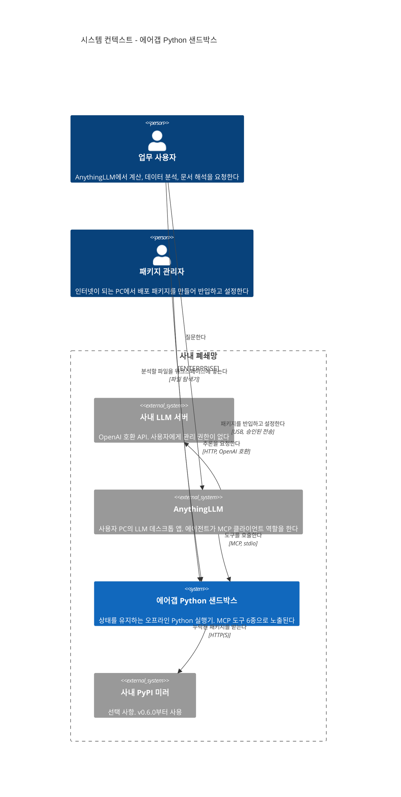
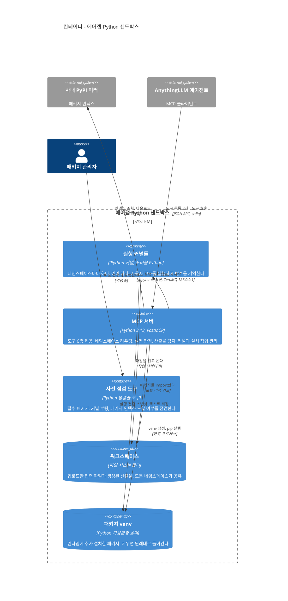
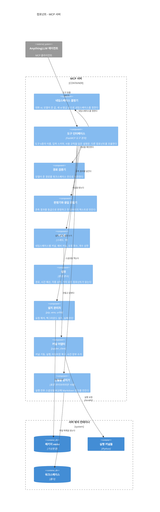
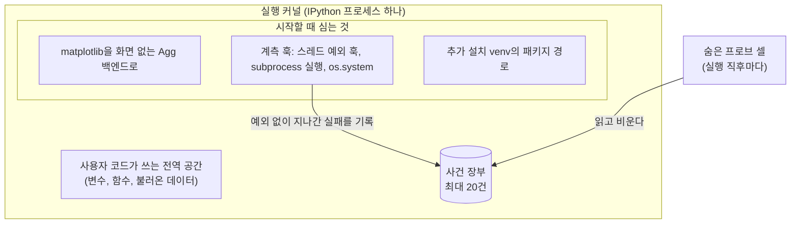

# 3-1. 정적 뷰 (Static View)

정적 뷰는 시스템을 멈춰 세워 놓고 본 모습이다. 어떤 부품이 있고, 부품마다 무엇을 책임지며, 누가 누구에게 기대는지를 다룬다. C4 모델의 1단계부터 3단계까지 차례로 확대해 들어간다.

## 1. 시스템 컨텍스트 (C4 1단계)



가장 바깥에서 보면 이 그림에서 눈여겨볼 점이 세 가지다.

첫째, 샌드박스는 LLM과 직접 이야기하지 않는다. 모든 호출은 AnythingLLM을 거친다. 샌드박스 입장에서 사용자는 AnythingLLM 에이전트, 더 정확히는 그 뒤에서 도구를 고르는 모델이다. 원격 LLM 서버는 샌드박스가 존재하는지조차 모른다. 모델은 도구 목록과 도구가 돌려준 텍스트만 볼 뿐이다.

둘째, 파일을 올리는 기능이 따로 없다. 사용자가 탐색기로 워크스페이스 폴더에 파일을 넣으면 그것으로 끝이다. 모델은 파일 목록 도구로 그 파일을 발견하고, 코드에서 파일 이름으로 읽는다. 기능을 하나 덜 만든 대신 사용자가 익숙한 방법을 그대로 쓰게 했다.

셋째, 외부로 나가는 선은 미러를 향한 한 줄뿐이고 그마저 선택 사항이다. 미러가 없어도 나머지 기능은 모두 동작한다.

## 2. 컨테이너 (C4 2단계)

시스템 상자를 열면 다음과 같다.



### 2.1 컨테이너별 책임

| 컨테이너 | 기술 | 책임 | 수명 |
|---|---|---|---|
| MCP 서버 | Python 3.13, FastMCP, jupyter_client | 도구 제공, 네임스페이스 결정, 커널 풀 관리, 판정과 응답 조립, 산출물 탐지, 경로 검증, 설치 작업 관리 | AnythingLLM이 켤 때부터 끌 때까지 |
| 실행 커널 | ipykernel(포터블 Python 위) | 사용자 코드 실행, 변수 보관, 사건 장부 기록 | 네임스페이스가 생길 때부터 회수되거나 서버가 꺼질 때까지. 동시에 최대 8개와 예비 1개 |
| 워크스페이스 | 폴더 | 입력 파일과 산출물 보관 | 영구. 서버가 꺼져도 남는다 |
| 패키지 venv | 가상환경 폴더 | 추가 설치한 패키지 보관 | 영구. 폴더를 지우면 초기화된다 |
| 사전 점검 도구 | 명령줄 스크립트 | 배포 환경이 준비되었는지 확인 | 사람이 실행할 때만 |

### 2.2 연결 방식

| 연결 | 방식 | 오가는 것 |
|---|---|---|
| AnythingLLM → MCP 서버 | JSON-RPC 2.0, stdio | `initialize`, `tools/list`, `tools/call`, 진행 알림 |
| MCP 서버 → 커널 | Jupyter 메시징, ZeroMQ, 127.0.0.1 | 실행 요청, 출력·결과·예외·상태 메시지, 인터럽트, 재시작 |
| 커널 → 워크스페이스 | 파일 입출력 | 사용자 코드가 여는 모든 파일. 커널의 작업 디렉터리가 워크스페이스다 |
| MCP 서버 → 워크스페이스 | 파일 입출력 | 파일 목록과 수정 시각·크기(스냅샷), 저장 도구의 쓰기 |
| MCP 서버 → 패키지 venv | 하위 프로세스 | venv 생성, `pip install` 실행 |
| MCP 서버(pip) → 미러 | HTTP(S) | 인덱스 조회, 휠 다운로드. 설치할 때만 |
| 커널 → 패키지 venv | 모듈 검색 경로 | 설치된 패키지 import |

### 2.3 이 구조에서 읽어 낼 것

**서버와 커널은 서로 다른 인터프리터일 수 있다.** 서버는 데이터 라이브러리를 하나도 import하지 않는다. 커널을 어떤 Python으로 띄울지는 설정값(`SANDBOX_KERNEL_PYTHON`)이 정한다. 배포 패키지에서는 둘 다 같은 WinPython을 쓰지만, 구조상으로는 분리되어 있어 필요하면 서버만 다른 Python으로 돌릴 수 있다([ADR-003](../adr/adr-003-separate-interpreters.md)).

**워크스페이스가 커널의 작업 디렉터리다.** 사용자 코드가 `chart.png`라고만 써도 워크스페이스에 저장된다. 파일 도구, 산출물 탐지기, 커널이 모두 "파일이 어디 있느냐"는 질문에 같은 답을 갖게 된 것은 v0.4.1부터다([ADR-016](../adr/adr-016-kernel-cwd-workspace.md)).

**venv는 워크스페이스 바깥에 있다.** 산출물 탐지기는 실행할 때마다 워크스페이스 전체를 훑는다. venv가 그 안에 있으면 패키지 하나를 설치할 때 생긴 파일 수천 개가 전부 "새 산출물"로 보고된다([ADR-019](../adr/adr-019-side-venv-installs.md)).

**서버는 사용자 데이터를 거의 들고 있지 않다.** 서버의 메모리에 있는 것은 네임스페이스와 커널의 대응표, 마지막 사용 시각, 진행 중인 설치 작업 목록 정도다. 사용자의 데이터는 커널의 메모리와 워크스페이스에만 있다. 그래서 서버를 재시작하면 모든 대화의 변수가 사라지지만 파일은 그대로 남는다.

## 3. 컴포넌트: MCP 서버 내부 (C4 3단계)

MCP 서버 컨테이너를 한 번 더 열어 보자.



도구 인터페이스가 가운데 위에 있고, 아래로 내려갈수록 서버 바깥의 자원에 가까워진다. 설정 컴포넌트는 거의 모든 컴포넌트가 읽기 때문에 화살표를 생략했다.

### 3.1 컴포넌트별 책임

**도구 인터페이스.** LLM이 보는 여섯 개 도구를 정의한다. 각 도구 함수는 얇다. 직접 일을 하기보다 다른 컴포넌트를 순서대로 불러 결과를 엮는다. 실행 계열 도구의 설명문에는 사용 규칙이 들어 있다([ADR-007](../adr/adr-007-rules-in-tool-descriptions.md)).

**네임스페이스 결정기.** 이번 호출이 어느 네임스페이스에 속하는지 정한다. 요청 메타데이터에 대화 id가 있으면 그것을 쓰고, 없으면 모델이 준 값을 쓰고, 모델이 `"new"`라고 하면 새 id를 발급한다. 모델이 준 값은 영문자, 숫자, 밑줄, 하이픈만 남기고 40자로 자른다([ADR-011](../adr/adr-011-namespace-argument.md)).

**커널 풀.** 네임스페이스 id와 커널의 대응표를 관리한다. 예비 커널을 하나 켜 두었다가 새 네임스페이스에 넘겨주고, 백그라운드 스레드로 30초마다 오래 쓰지 않은 커널을 정리하고 예비를 다시 채운다. 동시에 살아 있는 커널이 8개를 넘지 않도록 가장 오래 쓰지 않은 것부터 내보낸다([ADR-012](../adr/adr-012-kernel-pool-per-namespace.md)).

**커널 어댑터.** 커널 하나를 감싸는 부품이다. 풀이 커널 수만큼 만든다. 설정된 인터프리터로 커널을 띄우고, 작업 디렉터리를 워크스페이스로 잡고, 시작 직후 계측 코드를 심는다. 실행 요청을 보내고 결과를 모으며, 시간을 넘기면 인터럽트했다가 끝내 안 되면 재시작한다. 실행이 끝날 때마다 사건 장부를 수거한다. 모든 조작은 커널별 락 안에서 이루어진다.

**산출물 탐지기.** 워크스페이스의 모든 파일에 대해 (수정 시각, 크기)를 기록한 스냅샷을 만들고, 두 스냅샷을 비교해 새로 생기거나 바뀐 파일을 찾는다. 이미지는 본문에 보이는 Markdown 이미지로, 나머지는 링크로 만든다([ADR-005](../adr/adr-005-snapshot-diff-artifacts.md)).

**경로 검증기.** 두 가지 경우를 다룬다. 이미 있는 파일을 가리켜야 할 때(스크립트 실행)는 실제 파일이 워크스페이스 안에 있는지 확인한다. 새로 만들 파일일 때(텍스트 저장)는 아직 파일이 없으므로 상위 폴더를 기준으로 확인하고, 절대 경로, `..`, Windows 예약 장치 이름(`NUL`, `CON`, `COM1` 등)을 거부한다. 두 경우 모두 `./workspace/` 접두사는 떼고 해석한다.

**판정기와 응답 조립기.** 커널 어댑터가 넘긴 관측 결과를 다섯 가지 판정 중 하나로 등급을 매기고, 판정, 네임스페이스 안내, stderr, stdout, 마지막 식의 값, 산출물, 다음 행동 지시를 정해진 순서로 배치한 텍스트를 만든다. 도구가 요청 자체를 거절할 때도 실패한 실행과 같은 모양으로 답한다([ADR-006](../adr/adr-006-single-text-response.md), [ADR-017](../adr/adr-017-execution-verdict.md)).

**설치 관리자.** 모델이 준 패키지 문자열을 해석하고, venv를 만들고, pip을 실행하고, 실패하면 원인을 진단한다. 설치는 백그라운드 스레드에서 돌고, 같은 요청이 다시 오면 이미 돌고 있는 작업에 합류시킨다([ADR-019](../adr/adr-019-side-venv-installs.md), [ADR-020](../adr/adr-020-verify-installs-directly.md), [ADR-021](../adr/adr-021-tool-time-budget.md)).

**설정.** 모든 값을 환경 변수에서 읽고, 없으면 기본값을 쓴다. 상대 경로로 준 값은 서버 코드가 있는 폴더를 기준으로 해석한다. AnythingLLM 같은 호스트가 서버를 어떤 작업 디렉터리에서 띄우든 같은 폴더를 가리키게 하려는 것이다.

### 3.2 의존 방향에서 읽어 낼 것

**관측과 해석이 나뉘어 있다.** 커널 어댑터는 판정을 내리지 않는다. stdout, stderr, 예외 이름, 종료 코드, 사건 장부 항목처럼 관측한 사실만 넘긴다. 이것을 "RAN_WITH_ERRORS" 같은 등급으로 바꾸는 일은 판정기가 한다. v0.5.0에서 판정 체계를 통째로 바꿀 때 커널 쪽은 관측 항목을 몇 개 늘리는 데 그쳤고, 해석 규칙은 한곳에서 고쳤다.

**MCP를 모르는 부품이 많다.** 설치 관리자, 산출물 탐지기, 설정, 커널 어댑터와 커널 풀은 MCP SDK를 import하지 않는다. 덕분에 스모크 테스트의 상당 부분이 MCP SDK가 없는 최소한의 Python에서도 돈다. 설치 관리자는 나중에 명령줄 도구로 재사용할 수도 있다.

**도구 인터페이스는 얇게 유지한다.** 도구 함수에 로직이 쌓이기 시작하면, 같은 규칙이 도구마다 조금씩 다르게 구현된다. 이 프로젝트에서는 경로 검증과 산출물 탐지를 공용 부품으로 빼 두었기 때문에, v0.4.0에서 저장 도구를 추가할 때 같은 스냅샷 비교를 그대로 재사용할 수 있었다.

## 4. 커널 안에 심어 두는 것

커널은 순정 IPython이 아니다. 커널이 뜰 때마다(재시작 포함) 서버는 사용자에게 보이지 않는 초기화 코드를 먼저 실행한다.



**계측 훅**은 파이썬의 몇몇 지점을 감싸서, 예외를 일으키지 않고 지나가는 실패를 기록한다. 백그라운드 스레드에서 난 예외, 하위 프로세스가 0이 아닌 코드로 끝난 경우, `os.system`이 실패한 경우다. 감싼 훅은 원래 함수를 그대로 호출하므로 사용자가 보던 출력이 사라지지는 않는다.

**숨은 프로브 셀**은 매 실행이 끝난 직후 서버가 조용히 보내는 짧은 코드다. 사건 장부를 읽어 JSON 한 줄로 출력하고 장부를 비운다. 사용자 코드의 `print`와 섞이지 않도록 특수한 표식을 앞에 붙이고, IPython 실행 이력에 남지 않게 보내서 사용자가 쓰는 `_`(직전 결과) 값을 건드리지 않는다. 이 장치들이 왜 필요했는지는 [ADR-017](../adr/adr-017-execution-verdict.md)에 있다.

## 5. 외부 인터페이스

정적 뷰의 마지막으로, 시스템이 바깥에 드러내는 약속을 정리한다.

### 5.1 도구

| 도구 | 입력 | 하는 일 | 상태를 쓰나 | 응답 첫 줄 |
|---|---|---|---|---|
| `execute_python_code` | `code`, `namespace` | 네임스페이스의 커널에서 코드를 실행한다 | 쓴다 | `execution_status:` |
| `run_python_file` | `file_path`, `namespace` | 워크스페이스의 `.py` 파일을 스크립트로 실행한다 | 쓴다 | `execution_status:` |
| `write_workspace_file` | `filename`, `content`, `overwrite`(기본 false) | 텍스트를 실행 없이 파일로 저장한다 | 쓰지 않는다 | `write_status:` |
| `list_workspace_files` | 없음 | 워크스페이스의 파일을 크기, 확장자와 함께 나열한다 | 쓰지 않는다 | 파일 개수 |
| `install_python_packages` | `packages`, `namespace` | 사내 미러에서 별도 venv로 패키지를 설치한다 | 모든 커널에 반영 | `install_status:` |
| `reset_kernel_state` | `namespace` | 그 네임스페이스의 커널만 재시작한다 | 해당 네임스페이스 | 결과 문장 |

도구 수는 v0.1.0의 3개에서 6개로 늘었다. 늘어날 때마다 "모델이 비슷한 도구 사이에서 헷갈리지 않을까"를 따졌다. 이 이야기는 [4장](../04-designing-tools-for-llms.md)에서 다룬다.

### 5.2 상태 값 어휘

| 필드 | 값 | 뜻 |
|---|---|---|
| `execution_status` | `RAN_UNVERIFIED` | 예외 없이 끝났다. 과업이 성공했다는 증거는 아니다 |
| | `RAN_NO_OUTPUT` | 끝났지만 출력도, 바뀐 파일도 없다 |
| | `RAN_WITH_ERRORS` | 끝났지만 실행 중에 오류가 보고되었다 |
| | `FAILED` | 예외가 났거나, 0이 아닌 코드로 종료했거나, 도구가 요청을 거절했다 |
| | `TIMEOUT` | 제한시간에 걸려 중단되었다 |
| `install_status` | `INSTALLED` | 커널이 직접 각 패키지의 버전을 확인했다 |
| | `RUNNING` | 아직 설치 중이다. 실패가 아니다 |
| | `FAILED` | 설치하지 못했다. 이유를 한 문장으로 붙인다 |
| `write_status` | `SUCCESS` / `ERROR` | 파일을 썼는가 |

실행 판정에는 `SUCCESS`가 없는데 저장 도구에는 있다는 점이 눈에 띌 것이다. 파일 쓰기는 서버가 직접 한 일이고, 쓴 바이트가 파일에 있는지 서버가 확인할 수 있다. 반면 모델이 쓴 코드가 "사용자가 원한 일을 해냈는지"는 서버가 알 방법이 없다. 서버가 확인할 수 있는 것만 성공이라고 부른다는 원칙이 두 곳에 똑같이 적용된 결과다.

### 5.3 응답의 모양

실행 도구의 응답은 대략 이런 모양이다.

```
execution_status: RAN_UNVERIFIED
The interpreter finished without raising. That is NOT proof the task succeeded -- ...

active_namespace: ns-3fa1
Reusing your namespace. Keep passing namespace="ns-3fa1".

--- stdout ---
3월 합계: 12,480,000

--- artifacts ---
  (24.1 KB)

[reminder] your namespace = "ns-3fa1" -- pass it as `namespace` on your next call.
next_action: Read the output below and confirm it actually answers what was asked ...
```

stderr가 있으면 stdout보다 위에 온다. 아무것도 `print`하지 않았는데 마지막 줄이 식이었다면 `--- last expression ---` 절에 그 값이 나온다. 응답이 영어인 이유는 모델이 읽는 텍스트이기 때문이다. 이 배치가 왜 이렇게 되었는지는 [동적 뷰](02-dynamic-view.md)와 [4장](../04-designing-tools-for-llms.md)에서 설명한다.

## 생각해 볼 문제

1. 서버가 사용자 데이터를 거의 들고 있지 않다는 성질은 서버를 재시작할 때 어떤 이점과 손실을 가져오는가? 설치 작업 목록이 서버 메모리에만 있다는 사실은 어떤 상황에서 문제가 될까?
2. 커널 어댑터가 판정까지 내리게 하면 코드가 조금 더 짧아진다. 관측과 해석을 나눠서 얻는 이점을 v0.5.0의 변경 과정을 예로 들어 설명해 보자.
3. 파일 업로드 기능을 도구로 만들지 않고 탐색기에 맡긴 결정은 어떤 사용자에게 불편할 수 있을까?
