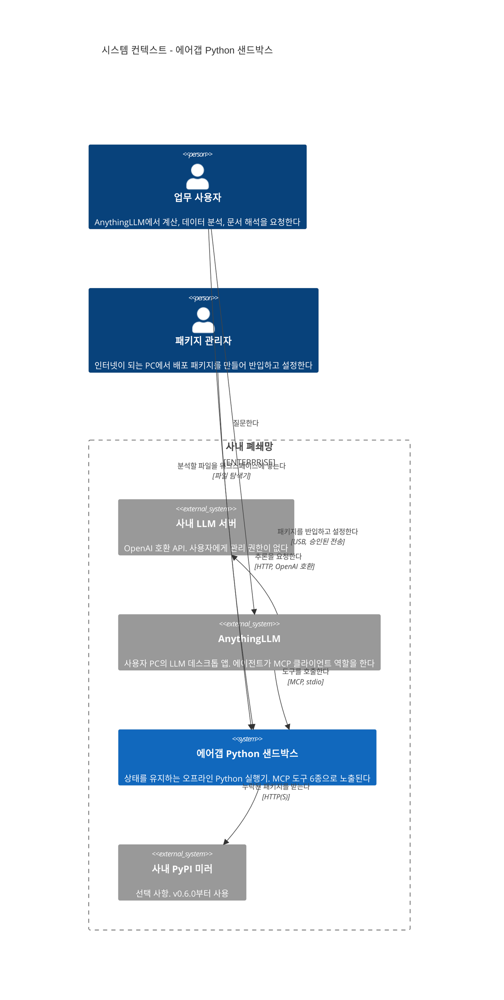
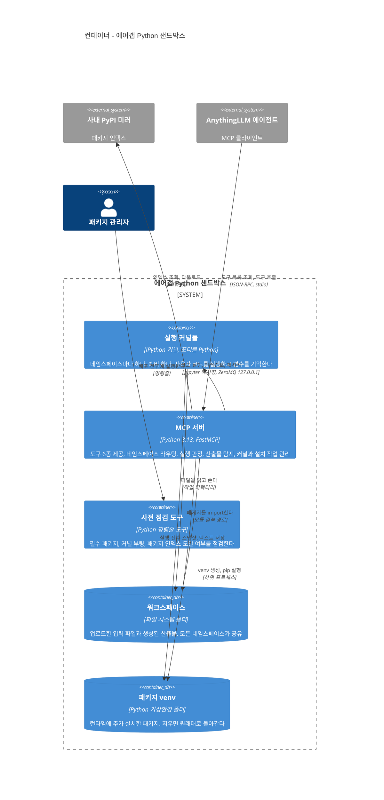
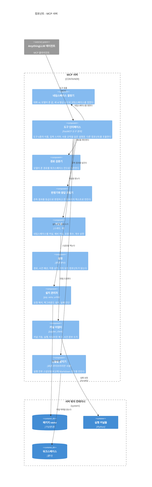
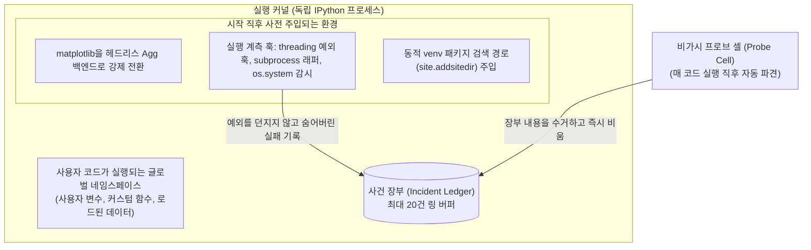

# 3-1. 정적 뷰 (Static View)

정적 뷰(Static View)는 시스템을 특정 시점에 정지된 상태로 바라본 구조적 청사진입니다. 시스템 내부에 어떤 부품(컨테이너와 컴포넌트)들이 존재하고, 각 부품이 어떤 책임을 전담하며, 이들 간의 의존 관계가 어떻게 연결되어 있는지를 다룹니다. C4 모델의 1단계부터 3단계까지 차례로 확대(Zoom-in)해 들어가며 시스템 구조를 분석해 보겠습니다.

## 1. 시스템 컨텍스트 (C4 1단계)



최상위 시스템 컨텍스트 수준에서 주목해야 할 핵심 설계 특성은 다음 세 가지입니다.

첫째, 본 샌드박스 시스템은 원격 LLM 서버와 직접 통신하지 않습니다. 모든 도구 호출과 데이터 흐름은 로컬 데스크톱 앱인 AnythingLLM을 경유합니다. 샌드박스 입장에서의 호출자는 AnythingLLM 에이전트이며, 궁극적으로는 그 배후에서 자율적으로 도구를 선택하는 LLM 모델입니다. 원격 LLM 서버는 사용자 로컬 PC에 이러한 샌드박스 시스템이 존재하는지조차 인지하지 못하며, 오직 클라이언트가 전달해 준 도구 목록 메타데이터와 도구 실행 결과 텍스트만을 컨텍스트로 수신합니다.

둘째, 파일을 시스템 내부로 업로드하기 위한 별도의 전용 도구를 만들지 않았습니다. 사용자가 Windows 파일 탐색기를 열어 지정된 워크스페이스 폴더에 대상 파일을 복사해 넣는 것만으로 입력 준비가 끝납니다. LLM 에이전트는 파일 목록 조회 도구를 통해 해당 파일의 존재를 인지하고, Python 코드에서 파일명을 지정하여 직접 읽어 들입니다. 불필요한 파일 전송 프로토콜을 구현하는 대신, 사용자가 일상적으로 가장 익숙한 방식을 그대로 활용하도록 설계했습니다.

셋째, 폐쇄망 외부 또는 사내망 다른 시스템으로 향하는 네트워크 의존성은 사내 PyPI 미러 서버를 향한 단 한 줄뿐이며, 이마저도 선택적(Optional) 연동입니다. 사내 미러 서버가 구축되지 않은 환경이라 할지라도 사전 번들링된 기본 라이브러리만으로 샌드박스의 모든 핵심 기능은 완벽히 정상 동작합니다.

## 2. 컨테이너 구조 (C4 2단계)

시스템 경계 내부를 한 단계 확대하여 독립적으로 동작하는 프로세스와 저장소 단위(컨테이너)를 살펴보면 다음과 같습니다.



### 2.1 컨테이너별 역할과 책임

| 컨테이너 | 기반 기술 | 주요 책임 | 라이프사이클 및 수명 |
|---|---|---|---|
| MCP 서버 | Python 3.13, FastMCP, jupyter_client | 도구 노출, 네임스페이스 라우팅, 커널 풀 제어, 실행 결과 판정 및 응답 조립, 산출물 자동 탐지, 파일 경로 보안 검증, 패키지 설치 생명주기 관리 | AnythingLLM 클라이언트가 기동할 때 생성되어 클라이언트 종료 시 함께 종료됩니다. |
| 실행 커널들 | ipykernel (포터블 WinPython 환경) | 사용자 코드의 격리 실행, 메모리 내 변수 및 데이터 보존, 커널 내부 사건 장부(Incident Ledger) 기록 | 해당 네임스페이스가 활성화될 때 할당되어 유휴 회수(Idle Eviction)되거나 서버 종료 시까지 유지됩니다. (최대 8개 세션 커널 + 예비 커널 1개) |
| 워크스페이스 | OS 파일시스템 디렉터리 | 사용자가 배치한 원본 입력 파일 및 코드가 생성한 산출물 파일 영구 보관 | 영구 유지. 서버 프로세스가 종료되거나 재부팅되어도 삭제되지 않고 디스크에 보존됩니다. |
| 패키지 venv | Python 가상환경 디렉터리 | 런타임에 사내 미러로부터 추가 설치된 외부 패키지 바이너리 보관 | 영구 유지. 해당 폴더를 삭제하기만 하면 시스템 초기 깨끗한 상태로 즉시 원복됩니다. |
| 사전 점검 도구 | Python CLI 독립 스크립트 | 오프라인 환경에서 필수 패키지 완전성, 커널 부팅 가능 여부, 네트워크 설정 유효성을 일괄 검증 | 관리자나 사용자가 배포 및 문제 해결을 위해 수동으로 실행할 때만 동작합니다. |

### 2.2 컨테이너 간 인터페이스 및 통신 방식

| 연결 경로 | 통신 메커니즘 | 송수신 데이터 |
|---|---|---|
| AnythingLLM → MCP 서버 | JSON-RPC 2.0 (표준 입출력 stdio 파이프) | `initialize`, `tools/list`, `tools/call`, 그리고 실시간 진행률 알림 메시지 |
| MCP 서버 → 실행 커널들 | Jupyter 메시징 프로토콜 (ZeroMQ, 127.0.0.1) | 코드 실행 요청, 실행 표준 출력/에러, 최종 평가 결과, 런타임 예외, 커널 인터럽트 및 재시작 제어 명령 |
| 실행 커널들 → 워크스페이스 | 파일시스템 I/O | 사용자 코드가 읽고 쓰는 모든 물리 파일 (커널의 작업 디렉터리가 곧 워크스페이스로 매핑됩니다) |
| MCP 서버 → 워크스페이스 | 파일시스템 I/O | 파일 목록 및 수정 시간·크기 메타데이터 조회(스냅샷), 전용 저장 도구를 통한 파일 쓰기 |
| MCP 서버 → 패키지 venv | OS 하위 프로세스 (Subprocess) | 독립 venv 생성 명령, `pip install` 설치 명령 실행 |
| MCP 서버(pip) → 사내 미러 | HTTP/HTTPS 네트워크 통신 | 사내 저장소 패키지 인덱스 조회 및 휠(Wheel) 바이너리 다운로드 (설치 도구 호출 시에만 동작) |
| 실행 커널들 → 패키지 venv | Python 모듈 검색 경로 (`sys.path`) | 사이드 venv에 설치된 신규 패키지 모듈 동적 임포트 |

### 2.3 컨테이너 구조에서 도출되는 핵심 설계 원칙

**첫째, 서버 프로세스와 실행 커널 프로세스는 완전히 다른 Python 인터프리터로 동작할 수 있습니다.** MCP 서버 코드는 데이터 분석 라이브러리를 단 하나도 직접 임포트하지 않습니다. 커널을 어떤 Python 환경으로 기동할지는 환경 변수(`SANDBOX_KERNEL_PYTHON`)를 통해 완전히 분리하여 제어할 수 있습니다. 비록 배포 번들에서는 편의상 동일한 WinPython을 함께 사용하지만, 아키텍처 구조상 완벽히 분리되어 있으므로 필요하다면 서버 자체는 OS 표준 Python으로 돌리고 커널만 포터블 Python으로 구동하는 유연한 구성도 가능합니다([ADR-003](../adr/adr-003-separate-interpreters.md)).

**둘째, 워크스페이스 디렉터리가 곧 커널 프로세스의 현재 작업 디렉터리(cwd)입니다.** 따라서 사용자 코드가 별도의 경로 지정 없이 `plt.savefig("chart.png")`와 같이 상대 경로로만 저장하더라도 파일은 정확히 워크스페이스 내부에 저장됩니다. 파일 조작 도구, 산출물 탐지기, 그리고 커널이 모두 "파일의 기본 위치가 어디인가"라는 질문에 동일한 정답을 공유하게 된 것은 v0.4.1의 구조 개선 덕분입니다([ADR-016](../adr/adr-016-kernel-cwd-workspace.md)).

**셋째, 사이드 가상환경(venv)은 워크스페이스 디렉터리 경계 바깥에 독립 배치됩니다.** 산출물 탐지기는 매 실행 전후로 워크스페이스 전체 디렉터리를 스캔하여 신규 생성된 파일을 감지합니다. 만약 수천 개의 소스 및 캐시 파일이 생성되는 venv가 워크스페이스 내부에 위치한다면, 단 하나의 패키지를 설치했을 뿐인데 수천 개의 라이브러리 내부 파일이 전부 "새로운 사용자 산출물"로 오인되어 LLM 프롬프트에 쏟아지는 치명적인 부작용이 발생합니다([ADR-019](../adr/adr-019-side-venv-installs.md)).

**넷째, MCP 서버는 사용자 데이터를 메모리에 거의 들고 있지 않은 무상태(Stateless)에 가까운 구조를 유지합니다.** 서버 프로세스의 메모리에는 네임스페이스와 커널 객체의 매핑 테이블, 최종 접근 타임스탬프, 그리고 현재 진행 중인 백그라운드 설치 태스크 목록 정도만 가볍게 상주합니다. 실제 분석 데이터프레임이나 변수들은 백엔드 커널 프로세스의 메모리와 물리 워크스페이스 디스크에만 보관됩니다. 따라서 만약 MCP 서버 프로세스가 불의의 사고로 재시작되더라도, 파일시스템의 산출물들은 완벽하게 보존됩니다.

## 3. 컴포넌트: MCP 서버 내부 구조 (C4 3단계)

MCP 서버 컨테이너 내부를 다시 한 단계 확대하여 세부 소프트웨어 모듈과 컴포넌트 간의 상호작용을 살펴보겠습니다.



위 구조에서 도구 인터페이스 계층이 최상단에서 외부 요청을 수신하고, 하단으로 내려갈수록 실제 외부 자원(커널, 디스크, 가상환경)과 맞닿게 됩니다. 설정(Config) 컴포넌트는 시스템의 거의 모든 모듈이 참조하므로 다이어그램의 가독성을 위해 개별 연결 화살표는 생략했습니다.

### 3.1 컴포넌트별 세부 책임

**도구 인터페이스 (Tools Interface).** LLM이 인식하는 6가지 MCP 도구의 진입점을 선언합니다. 이 계층의 도구 함수들은 비즈니스 로직을 직접 수행하지 않고 극도로 얇게(Thin) 유지됩니다. 요청이 유입되면 하위 컴포넌트들을 정해진 순서에 따라 조율(Orchestration)하고 결과를 종합하여 반환하는 창구 역할만을 담당합니다. 실행 계열 도구의 독스트링 설명문 내부에는 모델의 실수를 방지하기 위한 핵심 사용 규칙들이 체계적으로 주입되어 있습니다([ADR-007](../adr/adr-007-rules-in-tool-descriptions.md)).

**네임스페이스 결정기 (Namespace Router).** 유입된 도구 호출이 어떤 대화 세션 네임스페이스에 귀속되어야 하는지를 확정합니다. 요청 컨텍스트에 클라이언트가 부여한 대화 ID가 존재하면 최우선으로 채택하고, 없을 경우 모델이 전달한 `namespace` 인자 값을 평가합니다. 만약 모델이 값을 생략하거나 `"new"`를 명시했다면 서버가 새로운 고유 ID를 발급합니다. 모델이 전달한 문자열은 영문 대소문자, 숫자, 밑줄, 하이픈만을 허용하는 엄격한 새니타이징(Sanitization)을 거쳐 최대 40자로 정규화됩니다([ADR-011](../adr/adr-011-namespace-argument.md)).

**커널 풀 (Kernel Pool).** 활성화된 네임스페이스 ID와 실제 커널 인스턴스 간의 매핑을 관리합니다. 신규 대화의 첫 실행 지연(Cold Start)을 완전히 없애기 위해 '예비 커널(Pre-warmed Kernel)' 1개를 백그라운드에 상시 가동해 두었다가 신규 네임스페이스 요청이 들어오면 즉각 할당합니다. 백그라운드 유지보수 스레드가 30초마다 기상하여 오랫동안 사용되지 않은 유휴 커널을 메모리에서 해제하고 예비 커널을 다시 채웁니다. 또한 시스템 전체의 동시 활성 커널 개수가 최대 8개를 초과하지 않도록 LRU(가장 오래 미사용된 커널 우선 회수) 정책을 엄격히 적용합니다([ADR-012](../adr/adr-012-kernel-pool-per-namespace.md)).

**커널 어댑터 (Kernel Adapter).** 개별 Jupyter 커널 프로세스 하나를 1:1로 캡슐화하는 핵심 제어 모듈입니다. 풀에 의해 커널 수만큼 인스턴스화됩니다. 지정된 Python 인터프리터 경로를 기반으로 커널 서브프로세스를 생성하고, 작업 디렉터리를 워크스페이스로 바인딩하며, 커널 기동 직후 시스템 초기화 및 계측 코드를 자동으로 주입합니다. ZeroMQ 소켓을 통해 실행 요청을 전송하고 표준 출력 스트림을 집계하며, 설정된 타임아웃 예산을 초과할 경우 안전한 인터럽트 및 프로세스 강제 재시작 복구를 전담합니다. 실행이 완료될 때마다 커널 내부에 누적된 사건 장부(Incident Ledger)를 안전하게 수거합니다. 모든 작업은 개별 커널 단위의 독립 재진입 락(`RLock`) 내부에서 완벽하게 직렬화되어 실행됩니다.

**산출물 탐지기 (Artifact Detector).** 워크스페이스 내부의 모든 파일에 대해 `(수정 일시, 파일 크기)` 튜플로 구성된 파일시스템 스냅샷을 생성합니다. 코드 실행 직전과 직후에 찍은 두 스냅샷의 차이점(Diff)을 정밀 대조하여 새롭게 생성되었거나 내용이 변경된 파일을 정확히 식별해 냅니다. 탐지된 파일 중 이미지 포맷(PNG, JPG 등)은 LLM 및 사용자 화면에 즉각 렌더링되도록 마크다운 이미지 태그로 변환하고, 기타 일반 데이터 파일은 상대 경로 다운로드 링크 형태로 변환합니다([ADR-005](../adr/adr-005-snapshot-diff-artifacts.md)).

**경로 검증기 (Path Guard).** 보안 샌드박스의 핵심 수문장으로서 두 가지 시나리오의 경로 유효성을 철저히 검증합니다. 이미 디스크에 존재하는 파일을 참조해야 하는 경우(스크립트 실행)에는 정규화된 절대 경로가 워크스페이스 루트 경계 내에 실제로 존재하는지 확인합니다. 새롭게 생성할 파일인 경우(텍스트 파일 저장)에는 대상 파일이 아직 없으므로 부모 디렉터리 경로를 기준으로 경계를 검증하며, 상위 경로 탈출(`..`), 절대 경로 기재, 그리고 Windows 시스템 예약 장치명(`NUL`, `CON`, `PRN`, `AUX`, `COM1`~`COM9` 등)의 사용을 엄격히 차단합니다. 또한 소형 LLM이 관습적으로 덧붙이는 `./workspace/` 상대 접두사는 검증 과정에서 유연하게 제거하여 투명하게 정규화합니다.

**판정기와 응답 조립기 (Responder & Verdict Engine).** 커널 어댑터가 보고한 로우 레벨 실행 관측 결과를 바탕으로 5가지 표준 실행 상태 등급 중 하나를 객관적으로 판정합니다. 판정 등급, 현재 네임스페이스 안내, stderr 오류 메시지, stdout 표준 출력, 최종 표현식 평가값, 산출물 목록, 그리고 모델의 후속 행동 지침(Next Action)을 정해진 우선순위 템플릿에 따라 배치하여 단 하나의 일체형 텍스트 블록으로 조립합니다. 도구 입력 인자가 잘못되어 요청 자체가 사전 거절된 경우에도 동일한 일관된 포맷으로 오류 응답을 생성하여 모델의 혼란을 방지합니다([ADR-006](../adr/adr-006-single-text-response.md), [ADR-017](../adr/adr-017-execution-verdict.md)).

**설치 관리자 (Package Installer).** 모델이 도구 인자로 전달한 패키지 설치 문자열을 안전하게 파싱 및 정규화하고, 격리된 사이드 venv를 구축하며, 백그라운드 스레드에서 pip 명령을 실행합니다. 설치가 실패할 경우 네트워크 단절, 저장소 미러 불일치, 패키지명 오기 등 근본 원인을 진단하여 명확한 오류 피드백을 생성합니다. 만약 동일한 패키지 설치 요청이 중복해서 들어올 경우 새로운 프로세스를 중복 생성하지 않고 이미 백그라운드에서 진행 중인 태스크에 안전하게 합류(Join)시킵니다([ADR-019](../adr/adr-019-side-venv-installs.md), [ADR-020](../adr/adr-020-verify-installs-directly.md), [ADR-021](../adr/adr-021-tool-time-budget.md)).

**환경 설정 (Configuration).** 시스템 운영에 필요한 모든 설정값을 OS 환경 변수로부터 로드하며, 환경 변수가 지정되지 않은 경우 안정적인 기본값을 사용합니다. 환경 변수로 전달된 상대 경로는 실행 당시의 임의 작업 디렉터리가 아닌, MCP 서버 소스 코드가 위치한 기준 디렉터리를 중심으로 절대 경로화됩니다. 이를 통해 AnythingLLM이나 외부 런처가 서버 프로세스를 어떤 엉뚱한 작업 디렉터리에서 구동하더라도 항상 동일한 설정과 워크스페이스를 정확히 바라보도록 보장합니다.

### 3.2 컴포넌트 간 결합도와 의존 방향의 특징

**첫째, 사실의 '관측(Observation)'과 의미의 '해석(Interpretation)' 책임을 철저히 분리했습니다.** 하위 계층인 커널 어댑터는 코드 실행이 성공했는지 실패했는지에 대한 가치 판단을 직접 내리지 않습니다. 오직 표준 출력 문자열, 표준 에러 문자열, 포착된 예외 클래스명, 프로세스 종료 코드, 사건 장부 수거 항목 등 객관적으로 '관측된 원시 사실'만을 담백하게 반환합니다. 이 관측 데이터를 바탕으로 `RAN_WITH_ERRORS`나 `RAN_UNVERIFIED`와 같은 최종 신뢰도 등급을 부여하는 작업은 판정기 컴포넌트가 전담합니다. 덕분에 v0.5.0에서 실행 판정 체계를 전면 재설계할 때도 커널 통신 계층의 코드는 거의 수정할 필요가 없었으며, 판정 룰셋만을 독립적으로 안전하게 교체할 수 있었습니다.

**둘째, 핵심 모듈의 대다수가 MCP 프로토콜 자체를 전혀 모르는 순수 Python 컴포넌트로 구성되어 있습니다.** 설치 관리자, 산출물 탐지기, 환경 설정 모듈, 커널 어댑터 및 커널 풀은 `mcp` SDK 패키지를 일절 임포트하지 않습니다. 이 뛰어난 분리 덕분에 시스템 단위 테스트와 스모크 테스트(Smoke Test)의 상당 부분을 무거운 MCP 환경 없이도 일반 Python 런타임에서 초고속으로 검증할 수 있습니다. 또한 향후 설치 관리자나 실행 엔진 모듈만을 떼어내어 독립 CLI 도구로 재사용하는 것도 매우 용이합니다.

**셋째, 도구 인터페이스 계층을 극도로 얇게(Thin Layer) 유지했습니다.** 개별 도구 함수 내부에 비즈니스 로직이나 검증 코드가 직접 작성되기 시작하면, 도구의 종류가 늘어남에 따라 동일한 검증 규칙이 미묘하게 다르게 중복 구현되는 코드 부패가 발생합니다. 본 프로젝트는 경로 검증이나 파일 스냅샷 탐지와 같은 공통 기능을 독립 컴포넌트로 분리해 두었기 때문에, v0.4.0에서 파일 저장 전용 도구를 새롭게 추가할 때도 기존의 검증 및 스냅샷 엔진을 단 한 줄의 중복 없이 완벽하게 재사용할 수 있었습니다.

## 4. 커널 내부에 사전 주입하는 계측 장치

샌드박스가 가동하는 커널은 아무것도 설정되지 않은 순정 상태의 IPython이 아닙니다. 새로운 커널 프로세스가 기동되거나 타임아웃 등으로 인해 재시작될 때마다, 서버는 사용자의 코드가 실행되기 전에 시스템 내부 초기화 코드를 보리지 않게 먼저 실행합니다.



**사전 주입 계측 훅(Instrumentation Hooks)**은 Python 런타임의 주요 인터페이스를 가로채어, 일반적인 `try-except` 블록으로는 감지되지 않고 조용히 숨어버리는 런타임 실패들을 포착합니다. 대표적으로 백그라운드 워커 스레드 내부에서 발생한 처리되지 않은 예외(`threading.excepthook`), `subprocess.run` 등의 하위 프로세스가 0이 아닌 실패 코드로 종료된 상황, 그리고 `os.system` 호출이 실패한 경우가 이에 해당합니다. 주입된 훅은 원본 함수의 동작과 콘솔 출력을 100% 온전히 유지하면서, 내부 실패 사건의 요약 정보만을 사건 장부(Incident Ledger)에 조용히 기록합니다.

**비가시 프로브 셀(Invisible Probe Cell)**은 사용자가 요청한 코드 블록의 실행이 완전히 끝난 직후, MCP 서버가 사용자 모르게 커널로 신속히 파견하는 아주 짧은 내부 감사 코드입니다. 사건 장부에 쌓여 있는 실패 기록들을 읽어 단 한 줄의 JSON 규격 문자열로 출력한 뒤 장부를 깨끗이 비웁니다. 이때 프로브 셀의 출력은 사용자 코드가 콘솔에 출력한 일반 `print` 텍스트와 절대 뒤섞이지 않도록 특수한 UUID 접두사 마커를 부착하여 추출합니다. 또한 IPython의 실행 히스토리 카운트를 증가시키지 않는 특수 실행 옵션으로 전송되므로, 사용자가 직전 실행 결과를 참조할 때 사용하는 특수 변수인 `_`의 값을 전혀 오염시키지 않습니다. 이러한 정교한 계측 장치가 왜 필요했는지는 [ADR-017](../adr/adr-017-execution-verdict.md)에서 자세히 설명합니다.

## 5. 외부에 노출되는 표준 인터페이스 명세

정적 뷰의 마무리로서, 본 샌드박스 시스템이 외부(AnythingLLM 및 LLM 모델)에 공식적으로 제공하는 인터페이스 규격을 정리합니다.

### 5.1 제공 도구 6종 목록

| 도구 명칭 | 필수 입력 인자 | 주요 수행 역할 | 커널 상태 보존 여부 | 응답 헤더 첫 줄 |
|---|---|---|---|---|
| `execute_python_code` | `code`, `namespace` | 지정된 네임스페이스 커널에서 Python 코드를 실행하고 결과를 반환합니다. | 상태 보존 (Stateful) | `execution_status:` |
| `run_python_file` | `file_path`, `namespace` | 워크스페이스 내에 저장된 `.py` 스크립트 파일을 실행하고 결과를 커널에 반영합니다. | 상태 보존 (Stateful) | `execution_status:` |
| `write_workspace_file` | `filename`, `content`, `overwrite`(기본 false) | 코드 실행 없이 순수 텍스트 데이터를 워크스페이스 내 파일로 안전하게 기록합니다. | 상태 미사용 (Stateless) | `write_status:` |
| `list_workspace_files` | (인자 없음) | 워크스페이스 내에 존재하는 모든 파일의 목록과 크기, 확장자 정보를 조회합니다. | 상태 미사용 (Stateless) | 파일 총 개수 요약 |
| `install_python_packages` | `packages`, `namespace` | 사내 PyPI 미러로부터 사이드 venv에 패키지를 동적 설치하고 활성 커널에 즉시 반영합니다. | 전체 커널에 즉각 반영 | `install_status:` |
| `reset_kernel_state` | `namespace` | 특정 네임스페이스에 할당된 Jupyter 커널 프로세스만을 안전하게 강제 재시작합니다. | 해당 세션 초기화 | 상태 리셋 안내 문장 |

도구의 개수는 초기 v0.1.0 당시 3개에서 현재 6개로 점진적으로 확장되었습니다. 새로운 도구를 추가할 때마다 "추론 능력이 약한 소형 모델이 비슷한 도구 사이에서 용도를 혼동하지 않을까"라는 모델 친화성 관점의 영향 평가를 철저히 거쳤습니다. 이에 대한 상세한 인터페이스 설계 철학은 [4장](../04-designing-tools-for-llms.md)에서 심도 있게 다룹니다.

### 5.2 표준 상태 코드 어휘 체계

| 결과 필드명 | 표준 상태 값 | 정확한 상태 의미와 보장 범위 |
|---|---|---|
| `execution_status` | `RAN_UNVERIFIED` | 코드가 치명적인 예외를 던지지 않고 인터프리터를 통과했습니다. 단, 사용자가 요청한 비즈니스 과업이 실제로 성공했음을 보장하지는 않습니다. |
| | `RAN_NO_OUTPUT` | 코드가 정상 종료되었으나, 표준 출력(stdout)도 없고 워크스페이스 내에 생성되거나 변경된 산출물 파일도 전혀 없습니다. |
| | `RAN_WITH_ERRORS` | 코드가 인터프리터를 끝까지 통과했으나, 백그라운드 스레드 크래시나 하위 프로세스 실패 등 런타임 오류가 계측 장부에 기록되었습니다. |
| | `FAILED` | 코드 실행 도중 처리되지 않은 예외가 발생했거나, 스크립트가 0이 아닌 에러 코드로 종료되었거나, 도구 입력 검증 단계에서 요청이 거부되었습니다. |
| | `TIMEOUT` | 설정된 시간 예산(Timeout Budget)을 초과하여 커널 인터럽트 또는 강제 프로세스 재시작 조치가 단행되었습니다. |
| `install_status` | `INSTALLED` | pip 명령이 성공했을 뿐만 아니라, 커널 내부에서 `importlib.metadata`를 통해 각 패키지의 정상 로딩을 최종 검증 완료했습니다. |
| | `RUNNING` | 대용량 패키지 설치 작업이 백그라운드에서 정상적으로 진행 중입니다. 결코 실패 상태가 아닙니다. |
| | `FAILED` | 네트워크 단절이나 패키지 미존재 등으로 설치에 최종 실패했습니다. 정확한 원인 진단 메시지가 함께 제공됩니다. |
| `write_status` | `SUCCESS` / `ERROR` | 파일시스템에 물리 파일 쓰기가 원자적으로 성공했는지 여부를 나타냅니다. |

여기서 매우 흥미로운 설계적 차이점을 발견할 수 있습니다. 코드 실행 도구(`execute_python_code`)의 판정 결과에는 `SUCCESS`라는 단어가 의도적으로 완전히 배제되어 있는 반면, 파일 기록 도구(`write_workspace_file`)에는 `SUCCESS` 상태가 당당히 존재합니다. 그 이유는 명확합니다. 파일 쓰기는 MCP 서버가 파일시스템 API를 통해 디스크에 바이트를 직접 기록한 행위이므로, 실제 파일이 올바른 크기로 기록되었는지를 서버가 100% 완벽하게 검증할 수 있습니다. 반면 모델이 작성하여 실행한 Python 코드가 사용자의 원래 의도나 비즈니스 요구사항을 정말로 만족시켰는지는 실행 환경인 서버가 결코 알 수 없습니다. "시스템이 객관적으로 증명할 수 있는 사실만을 정직하게 성공으로 선언한다"는 핵심 원칙이 두 인터페이스에 철저히 적용된 결과입니다.

### 5.3 모델 반환 응답의 텍스트 레이아웃 구조

코드 실행 계열 도구가 반환하는 최종 응답 텍스트는 표준적으로 다음과 같은 정형화된 레이아웃을 갖춥니다.

```
execution_status: RAN_UNVERIFIED
The interpreter finished without raising. That is NOT proof the task succeeded -- ...

active_namespace: ns-3fa1
Reusing your namespace. Keep passing namespace="ns-3fa1".

--- stdout ---
3월 합계: 12,480,000

--- artifacts ---
  (24.1 KB)

[reminder] your namespace = "ns-3fa1" -- pass it as `namespace` on your next call.
next_action: Read the output below and confirm it actually answers what was asked ...
```

만약 실행 중 표준 에러(stderr)가 발생했다면, 모델이 문제 상황을 가장 먼저 인지할 수 있도록 표준 출력(stdout)보다 위쪽 최상단에 배치됩니다. 만약 코드가 `print()`를 명시적으로 호출하지 않았더라도 마지막 라인이 단독 표현식이었다면 `--- last expression ---` 섹션에 해당 평가 결과가 친절히 노출됩니다. 응답 텍스트가 한국어가 아닌 영어로 구성된 이유는 이 텍스트를 직접 읽고 해석하는 주체가 한국어보다 영어 프롬프트 이해력이 월등히 높은 소형 LLM이기 때문입니다. 이러한 정보 배치가 모델의 환각을 억제하는 구체적인 원리는 [동적 뷰](02-dynamic-view.md)와 [4장](../04-designing-tools-for-llms.md)에서 자세히 설명해 드립니다.

## 생각해 볼 문제

1. MCP 서버가 사용자 세션 데이터를 메모리에 거의 보관하지 않는다는 아키텍처 특성은, 예기치 않은 서버 프로세스 재기동 상황에서 구체적으로 어떤 장점과 단점을 가져옵니까? 특히 장시간 소요되는 패키지 설치 작업 목록이 서버 메모리에만 유지된다는 점은 어떤 운영 환경에서 취약점이 될 수 있겠습니까?
2. 커널 어댑터 모듈이 최종 상태 판정까지 직접 내리도록 통합 구현했다면 전체 소스 코드 라인 수를 줄일 수 있었을 것입니다. 그럼에도 불구하고 '원시 사실의 관측'과 '등급의 해석'을 별도 컴포넌트로 명확히 분리함으로써 얻은 실질적인 아키텍처적 이점을 v0.5.0 판정 체계 개편 사례를 들어 설명해 보십시오.
3. 파일 업로드 기능을 복잡한 MCP 전용 API 도구로 개발하지 않고 OS 표준 파일 탐색기에 전적으로 맡기기로 한 설계 결정은, 일반적인 GUI 사용자에게는 편리하지만 어떤 특수한 사용자 계층이나 자동화 워크플로 관점에서는 오히려 제약이나 불편으로 작용할 수 있겠습니까?
