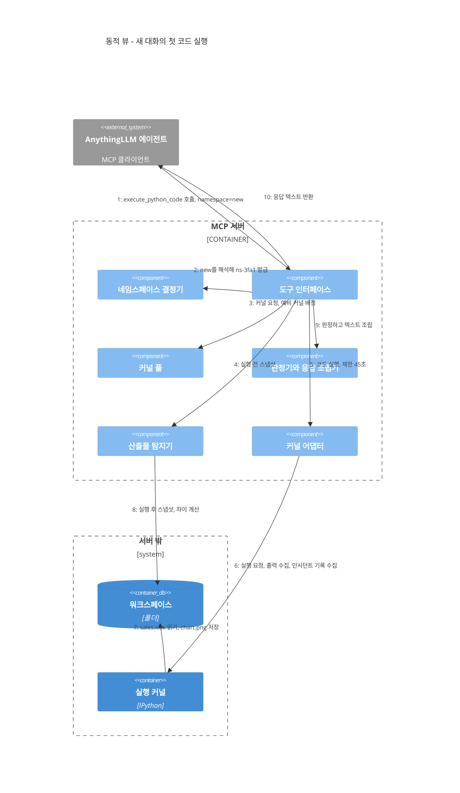
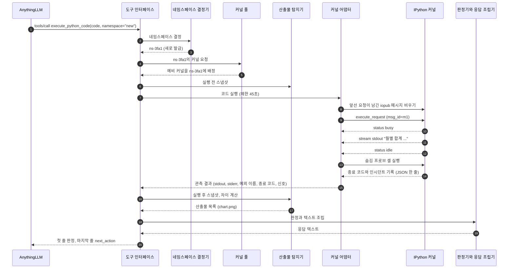
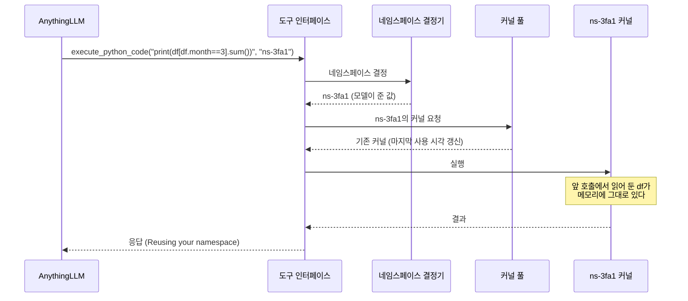
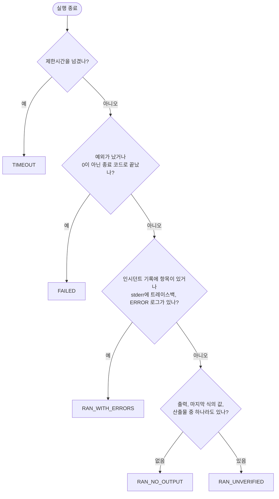
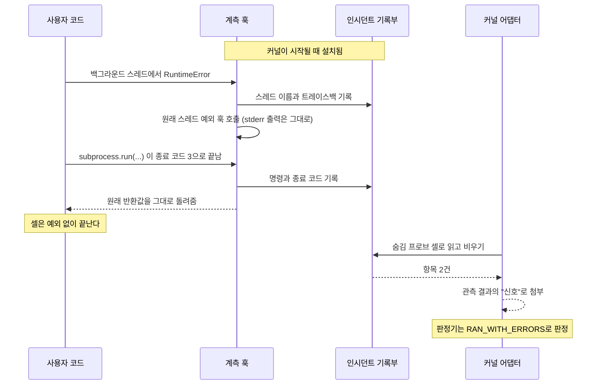
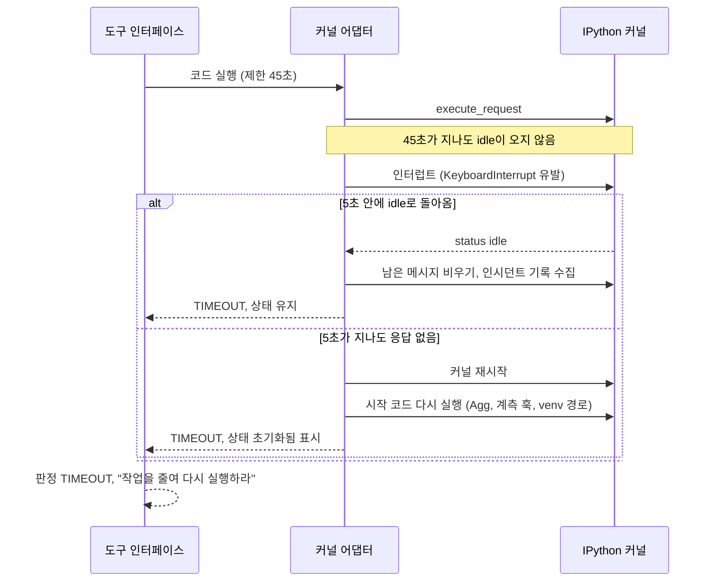
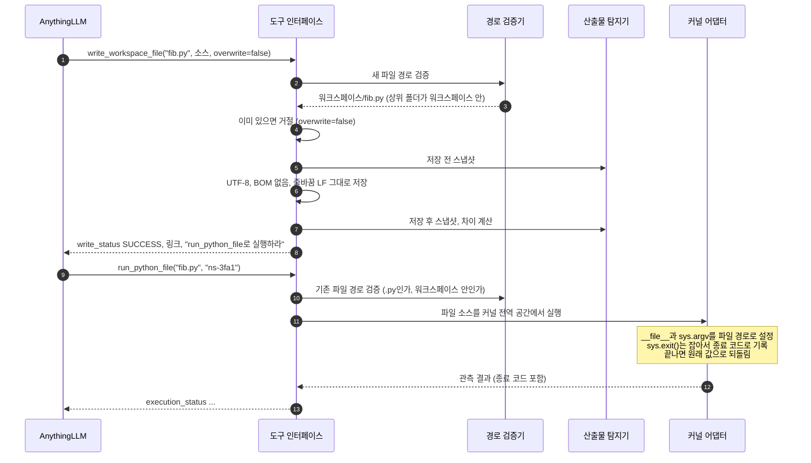
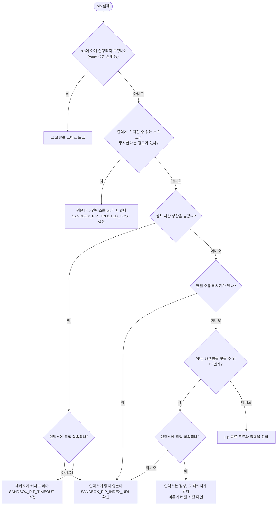
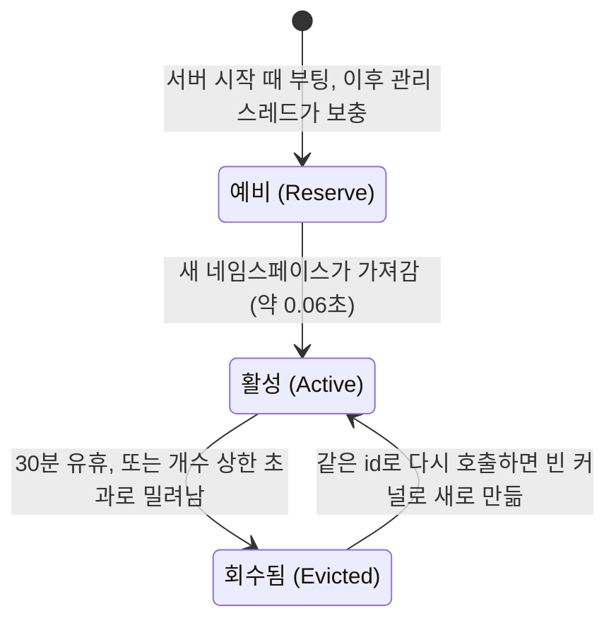
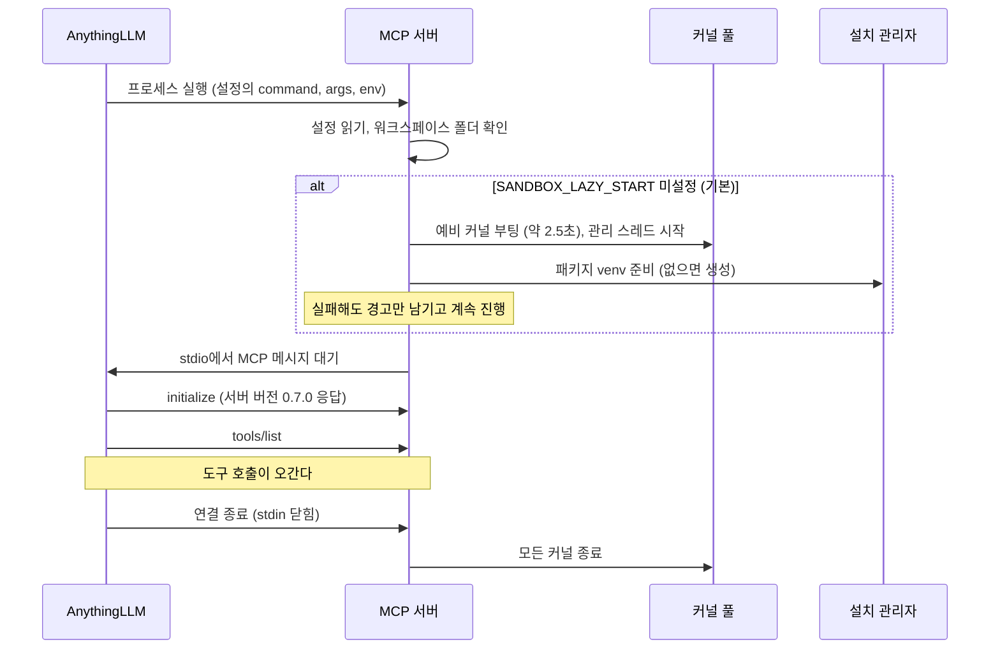

# 3-2. 동적 뷰 (Dynamic View)

정적 뷰가 시스템을 구성하는 부품 목록이라면, 동적 뷰(Dynamic View)는 그 부품들이 실제로 상호작용하며 동작하는 실행 흐름을 보여줍니다. 본 문서에서는 시스템 런타임에서 발생하는 대표적인 8가지 핵심 시나리오를 선정하여, 어떤 컴포넌트가 어떤 순서로 메시지와 데이터를 주고받는지를 단계별로 상세히 추적합니다.

| 핵심 시나리오 | 분석하여 전달하고자 하는 아키텍처 원리 |
|---|---|
| 1. 첫 코드 실행 | 가장 기본이 되는 실행 시퀀스: 네임스페이스 발급부터 실행 및 응답 조립까지의 전 과정 |
| 2. 후속 질문과 상태 지속성 | 이전 실행의 변수와 데이터프레임이 메모리에 그대로 유지되는 원리 |
| 3. 실행 결과 판정 알고리즘 | 로우 레벨 관측 데이터가 객관적인 신뢰도 등급으로 변환되는 엄격한 판정 룰셋 |
| 4. 예외 없는 실패의 능동적 포착 | 스레드 예외나 서브프로세스 오류를 감지하는 인시던트 기록부(Incident Ledger)의 동작 방식 |
| 5. 타임아웃 감시와 복구 전략 | 무한 루프나 블로킹에 빠진 커널을 인터럽트하고 안전하게 강제 재시작하는 복구 메커니즘 |
| 6. 스크립트 저장 후 직접 실행 | 워크스페이스 경로 보안 검증과 독립 스크립트의 실행 의미론(Semantics) |
| 7. 패키지 동적 설치와 시간 예산 관리 | 클라이언트 타임아웃(60초)을 방어하며 장시간 소요 작업을 완수하는 비동기 분할 기법 |
| 8. 네임스페이스와 서버의 라이프사이클 | 커널 프로세스가 생성, 사전 워밍업, 재사용, 유휴 회수되는 전체 생명주기 |

마지막 9절에서는 이러한 다양한 실행 흐름들이 동시에 발생할 때 시스템의 무결성을 지켜주는 동시성 제어 모델(Concurrency Model)을 종합적으로 정리해 드립니다.

## 1. 첫 코드 실행 시나리오

사용자가 새로운 대화 창을 열고 "sales.xlsx의 월별 매출 합계를 구해서 막대 차트로 그려줘"라고 요청하는 상황을 가정해 보겠습니다. AnythingLLM 에이전트는 `execute_python_code` 도구를 호출하면서 인자로 `namespace="new"`를 전달합니다. 먼저 C4 동적 다이어그램을 통해 거시적인 컴포넌트 간 상호작용 흐름을 살펴보겠습니다.

이 동일한 흐름을 세부 메시지 수준의 시퀀스 다이어그램으로 정밀하게 분해하면 다음과 같습니다.

각 단계별로 주목해야 할 핵심 설계 사항은 다음과 같습니다.

**2~3단계, 네임스페이스 신규 발급.** 모델이 `"new"`를 전달했으므로 서버가 `ns-` 접두사 뒤에 16진수 4자리를 조합한 고유 ID(예: `ns-3fa1`)를 즉시 생성합니다. 현재 활성화되어 있는 기존 네임스페이스들과 절대 충돌하지 않음을 확인한 후 확정합니다. 모델이 임의로 세션 ID를 지어내지 못하게 강제하는 이유는 [ADR-011](../adr/adr-011-namespace-argument.md)에 상세히 기술되어 있습니다.

**4~5단계, 사전 기동된 예비 커널 배정.** 새로운 IPython 커널 프로세스를 처음부터 부팅하는 데는 통상 약 2.5초가 소요됩니다. 커널 풀은 백그라운드에 미리 띄워 둔 '예비 커널'을 신규 네임스페이스에 즉시 인계하므로, 사용자는 프로세스 기동 지연을 거의 체감하지 않고 즉각(약 0.06초) 실행 단계로 진입합니다. 비워진 예비 커널 자리는 백그라운드 관리 스레드가 나중에 자동으로 보충합니다.

**6단계, 실행 전 파일시스템 스냅샷 생성.** 코드 실행에 돌입하기 직전, 워크스페이스 내에 존재하는 모든 파일의 수정 시각과 파일 크기를 신속히 측정하여 베이스라인 스냅샷을 생성합니다.

**8단계, 잔여 메시지 플러시(Flush).** ZeroMQ의 `iopub` 채널은 비동기 브로드캐스트 채널이므로, 이전 작업이나 비정상 종료된 요청이 뒤늦게 흘려보낸 잔여 메시지가 소켓 버퍼에 남아 있을 수 있습니다. 따라서 새로운 요청을 전송하기 직전에 소켓 버퍼를 완전히 비워두어 이전 실행의 출력이 현재 실행으로 섞이는 사태를 완벽히 차단합니다.

**9~12단계, 코드 실행 및 실시간 이벤트 스트림 수집.** 전송된 실행 요청의 `msg_id`와 일치하는 헤더를 가진 메시지만을 엄격히 선별하여 수집합니다. 출력은 `stdout`과 `stderr` 버퍼로 각각 분리하여 적재하고, 최종 단독 표현식 평가값이 감지되면 별도로 보관하며, 예외 발생 시 에러 트레이스백을 추출합니다. 커널로부터 최종적으로 `status: idle` 상태 메시지가 도착하면 정상 종료로 판단합니다. 만약 설정된 도구 시간 예산(기본 45초)을 초과할 경우 즉시 5번 시나리오(타임아웃 복구)로 분기합니다.

**13~14단계, 감사용 숨김 프로브 셀 실행.** 사용자 코드가 종료된 직후, 서버는 인시던트 기록부(Incident Ledger)를 안전하게 읽어오고 비우기 위한 아주 짧은 내부 감사 셀을 커널에서 실행합니다. 스크립트 실행 도구가 남겨둔 프로세스 종료 코드 역시 이 시점에 함께 수집됩니다(4번 시나리오 참조).

**16~17단계, 신규 산출물 자동 탐지 및 렌더링 포맷 변환.** 실행 직후의 파일시스템 스냅샷을 다시 촬영한 뒤 이전 스냅샷과의 차이점(Diff)을 대조합니다. 새롭게 생성되거나 내용이 변경된 파일 목록을 추출하고 최신 수정순으로 정렬합니다. 이때 `chart.png`와 같은 이미지 파일은 AnythingLLM 채팅 화면에 즉각 시각화되도록 `` 형태의 마크다운 이미지 문법으로 자동 변환합니다.

**18~20단계, 실행 판정 및 최종 응답 조립.** 판정기 모듈이 관측 결과를 바탕으로 표준 신뢰도 등급을 부여하고(3번 시나리오), 응답 조립기가 정형화된 일체형 텍스트를 구성합니다. 배치 순서는 실행 판정, 네임스페이스 안내, stderr 에러 내역, stdout 표준 출력, 최종 식 평가값, 산출물 링크, 네임스페이스 유지 알림, 그리고 모델의 후속 행동 지침(next_action) 순입니다. 판정이 최상단 첫 줄에 오고 지시문이 최하단 마지막 줄에 위치해야 하는 이유는 [4장](../04-designing-tools-for-llms.md)에서 자세히 설명합니다.

## 2. 후속 질문과 상태 지속성 시나리오

사용자가 이전 분석 결과에 이어 "그중 3월 데이터만 필터링해서 상세 내역을 보여줘"라고 후속 질문을 요청합니다. 모델은 이전 응답 텍스트에서 확인한 세션 ID인 `ns-3fa1`을 도구의 `namespace` 인자로 그대로 전달합니다.

이 시나리오에서 수백 MB에 달하는 대용량 엑셀 파일을 디스크에서 다시 읽어 들이지 않는다는 점이 바로 본 영속 커널 샌드박스의 핵심 가치입니다. 앞선 실행에서 로드해 둔 `df` 변수가 커널 프로세스의 메모리에 온전히 보존되어 있으므로, 후속 필터링 연산은 수 밀리초 이내에 완료됩니다.

반대로 만약 모델이 추론 실수로 인해 `namespace` 인자를 누락하거나 오타를 낼 경우, 서버는 이를 완전히 새로운 대화로 인식하여 빈 커널을 배정하게 됩니다. 이 경우 모델은 즉시 `NameError: name 'df' is not defined`라는 오류를 마주하게 됩니다. 이는 무상태 stdio 프로토콜 환경에서 모델의 자율성에 의존할 수밖에 없는 네임스페이스 설계의 가장 아쉬운 트레이드오프입니다.

## 3. 실행 결과 판정 알고리즘

코드 실행이 완료되면 판정기(Verdict Engine)는 커널 어댑터가 보고한 로우 레벨 관측 데이터를 아래 플로우차트에 정의된 엄격한 우선순위에 따라 순차적으로 평가하여 최종 등급을 부여합니다. 상단 규칙에 먼저 매칭되는 즉시 하위 규칙은 평가하지 않고 해당 등급으로 확정합니다.

이 판정 체계에는 현업 실무에서 수많은 시행착오 끝에 정립된 정교한 세부 룰셋들이 녹아 있습니다.

- 스크립트 코드가 명시적으로 `sys.exit(0)`을 호출하거나 인자 없이 `sys.exit()`를 호출한 경우, 이는 비정상 에러가 아닌 지극히 정상적인 프로그램 종료로 취급합니다. 아울러 IPython이 기본적으로 stderr에 출력하는 `"use %tb for traceback"` 잡음 텍스트 역시 말끔히 정제하여 제거합니다.
- stderr 스트림에 대한 정밀 패턴 매칭(트레이스백 헤더 탐지, `ERROR:` 또는 `CRITICAL:`로 시작하는 치명적 로그 라인 식별)은 예외 없이 인터프리터를 통과한 정상 셀에 대해서만 선별 적용합니다. 만약 처리되지 않은 예외가 발생한 셀이라면 그 자체로 이미 `FAILED` 등급에 해당하기 때문입니다.
- stdout 표준 출력에 찍힌 `FAIL`, `Error` 등의 임의 텍스트는 판정의 근거로 절대 사용하지 않습니다. 사용자가 비즈니스 로직 상 단순히 "로그인 실패 횟수: 3회"와 같은 일반 텍스트를 출력했을 뿐인데 시스템이 이를 런타임 장애로 오판하는 심각한 오탐(False Positive)을 방지하기 위함입니다.
- 모든 단계에서 오류가 전혀 발견되지 않았을 때 부여되는 최상의 등급은 결코 `SUCCESS`가 아닌 `RAN_UNVERIFIED`입니다. 앞서 강조했듯이, 인터프리터 수준에서 예외가 없었다는 사실이 모델이 작성한 비즈니스 로직이 사용자의 원래 요구사항을 올바르게 달성했다는 논리적 증거가 될 수는 없기 때문입니다([ADR-017](../adr/adr-017-execution-verdict.md)).

## 4. 예외 없이 묻히는 실패의 능동적 포착 (인시던트 기록부)

초기 v0.5.0 이전 버전에서는 코드 실행 중 예외(Exception)가 발생하지 않으면 무조건 성공으로 간주하여 보고했습니다. 그러나 실제 Python 환경에서는 치명적인 실패가 발생했음에도 예외를 상위로 던지지 않고 조용히 묻히는 오류 유형들이 존재합니다. 대표적인 사례가 백그라운드 워커 스레드 내부에서 발생한 크래시나, `subprocess.run()`으로 실행한 외부 CLI 프로세스가 0이 아닌 에러 코드를 반환하며 실패한 경우입니다. 셀의 메인 스레드 자체는 정상 종료되므로 표준 Jupyter 프로토콜로는 어떠한 `error` 이벤트도 발행되지 않습니다. 이러한 '드러나지 않는 실패'를 빠짐없이 잡아내기 위해 구축된 특수 감사 장치가 바로 **인시던트 기록부(Incident Ledger)**입니다.

여기서 프로브 셀은 사용자 코드가 예외를 발생시켜 명백히 실패했을 때도 반드시 예외 없이 실행되어 기록을 비워내야 합니다. 만약 기록을 즉시 비워두지 않는다면, 과거의 실패 기록이 메모리에 잔류하다가 한참 뒤에 실행된 전혀 무관한 후속 정상 호출에 엉뚱하게 첨부되어 "유령 오류(Ghost Failure)"를 유발하기 때문입니다.

이러한 정밀 계측 메커니즘을 유지하는 데 드는 비용은 매 실행마다 발생하는 아주 짧은 내부 커널 왕복 통신 1회뿐입니다. 다만 극히 미세한 타이밍적 한계는 존재합니다. 만약 백그라운드 스레드가 메인 코드와 프로브 셀의 실행이 모두 끝난 직후 비동기적으로 비정상 종료된다면, 해당 실패 내역은 다음 도구 호출 시점의 인시던트 기록부로 이월되어 수집됩니다. 비록 모델은 첨부된 상세 트레이스백을 통해 이전 작업의 오류임을 구분해 낼 수 있으나, 보고 시점이 한 턴 지연된다는 점은 비동기 멀티스레딩 환경의 내재적 한계라 할 수 있습니다.

## 5. 타임아웃 감시와 다단계 복구 전략

LLM이 작성한 코드에 무한 루프가 포함되어 있거나, 수 기가바이트의 초대형 연산을 수행하거나, 실수로 `time.sleep(600)`과 같은 장시간 블로킹 코드를 실행한 시나리오를 살펴보겠습니다.

인터럽트 신호만으로 프로세스가 즉각 중단되지 않는 현상이 발생하는 이유는 바로 타깃 운영체제인 Windows의 I/O 특성에 기인합니다. Windows 환경에서 Jupyter의 인터럽트 신호는 순수 Python 바이트코드로 동작하는 반복문은 0.2초 이내에 깔끔하게 중단시키지만, C 레벨에서 시스템 콜을 붙잡고 있는 블로킹 I/O나 `time.sleep` 호출은 인터럽트 신호로 깨워내지 못합니다.

따라서 1차 인터럽트 후 5초의 안전 유예 시간을 두고, 이 유예 시간 내에 커널이 `idle` 상태로 복귀하지 못하면 최후의 수단으로 커널 서브프로세스를 OS 레벨에서 강제 종료(Kill)하고 깨끗하게 재기동합니다. 커널이 강제 재시작되면 해당 네임스페이스의 메모리 변수들이 모두 소멸하므로, 서버는 모델이 상황을 명확히 인지할 수 있도록 반환 응답에 "상태가 초기화되었음"을 명시적으로 안내합니다. 복잡한 2단계 재시작 로직을 제거하고 싶은 유혹이 들 수 있으나, 이는 어떤 위험한 코드가 들어오더라도 전체 샌드박스 시스템이 영구 교착 상태에 빠지지 않도록 보장하는 가장 핵심적인 가용성 방어막입니다([ADR-008](../adr/adr-008-conventional-sandbox-timeouts.md)).

아울러 외부 요인으로 인해 커널 프로세스가 이미 비정상 종료되어 있는 상태라면, 커널 어댑터는 다음 코드 실행 요청을 처리하기 직전에 커널을 선제적으로 재부팅하여 항상 정상 상태를 보장합니다.

## 6. 스크립트 안전 저장 후 직접 실행

사용자가 "피보나치 수열을 구하는 스크립트를 작성하여 fib.py라는 파일로 저장한 뒤 직접 실행해 줘"라고 요청했습니다. v0.4.0 이후부터 모델은 이 요청을 파일 저장 전용 도구와 스크립트 실행 전용 도구의 2단계 독립 호출로 분할하여 안정적으로 처리합니다.

이 연계 흐름에서 적용되는 세부 안전 규칙들은 다음과 같습니다.

**신규 저장 경로에 대한 엄격한 검증.** 기록할 대상 파일이 아직 디스크에 없으므로 부모 디렉터리의 정규화된 절대 경로를 기준으로 경계를 확인합니다. 드라이브 문자(`C:`)나 절대 경로 표기, 상위 폴더 탈출 경로(`..`), 그리고 Windows 시스템 예약 장치명(`NUL`, `CON`, `PRN`, `AUX`, `COM1`~`COM9` 등)을 엄격히 차단합니다. Windows 환경에서는 이러한 특수 장치명에 파일을 쓸 경우 시스템이 에러를 발생시키지 않고 데이터를 조용히 폐기해 버리기 때문입니다. 하위 디렉터리 생성은 경로 검증을 완벽히 통과한 경우에만 안전하게 수행됩니다. 한편 모델이 `./workspace/fib.py`와 같이 상대 경로 접두사를 붙여 전달하더라도 검증기가 유연하게 전처리하여 수용합니다.

**기존 파일 덮어쓰기 기본 차단 (Safe Default).** 작업 워크스페이스에는 사용자가 직접 업로드한 소중한 원본 데이터 파일들이 함께 위치합니다. 모델의 사소한 실수로 중요한 원본 엑셀이나 CSV가 덮어써져 손실되는 위험을 막기 위해 기본값(`overwrite=false`) 상태에서는 덮어쓰기를 원천 차단합니다. 거절 응답에는 "정말 덮어쓰려면 `overwrite=true`를 전달하거나 다른 파일명을 사용하십시오"라는 구체적인 해결 가이드를 함께 제공합니다.

**물리 디스크 저장 검증.** 파일 기록 직후에도 스냅샷 차이 대조를 수행합니다. 만약 OS 파일시스템 오류 등으로 인해 쓰기 성공 판정에도 불구하고 실제 파일이 감지되지 않으면 조용한 실패로 간주하고 즉시 경고를 반환합니다.

**스크립트 실행 경로 검증.** `run_python_file` 호출 시에는 파일이 디스크에 반드시 실재해야 하고, 그 물리 경로가 워크스페이스 내부여야 하며, 파일 확장자가 반드시 `.py`여야 합니다. 이 모든 보안 검사가 완료되기 전에는 커널 프로세스에 어떠한 명령도 전달되지 않습니다.

**스크립트 전역 실행 의미론 (Execution Semantics).** 스크립트 소스코드는 커널의 전역 메모리 공간(Global Scope)에서 직접 평가됩니다. IPython의 전역 모듈명(`__name__`)은 기본적으로 `"__main__"`으로 정의되어 있으므로 소스 하단의 `if __name__ == "__main__":` 실행 블록이 정상적으로 가동됩니다. 함수와 변수는 바인딩되는 즉시 전역 공간에 등록되므로, 설령 스크립트가 중간에 `sys.exit()`를 호출하여 종료되거나 런타임 예외가 발생하더라도 그때까지 메모리에 로드된 함수와 분석 객체들은 다음 대화에서 온전히 재사용할 수 있습니다([ADR-010](../adr/adr-010-run-script-file.md)).

## 7. 패키지 동적 설치와 시간 예산 관리

모델이 데이터 분석 중 `import rapidfuzz`를 시도하다가 모듈 미설치 오류를 마주하고 패키지 설치 도구를 호출하는 시나리오입니다. 대용량 패키지의 경우 사내 미러 서버로부터 휠 파일을 다운로드하고 컴파일하는 데 1분 이상의 시간이 소요될 수 있습니다. 그러나 클라이언트인 AnythingLLM은 60초가 경과하면 요청을 강제 취소하므로, 서버는 반드시 45초 이내에 유효한 중간 응답을 반환해야 합니다.

이 비동기 흐름에는 시스템 안정성을 위한 다중 안전장치가 결합되어 있습니다.

**중복 작업 합류 (Task Coalescing).** 진행 중인 설치 태스크는 요청된 패키지 목록을 정렬한 정규화 문자열을 키(Key)로 삼아 레지스트리에 등록됩니다. 만약 모델이 동일한 인자로 도구를 다시 호출하면, 새로운 pip 프로세스를 중복 실행하지 않고 백그라운드에서 이미 돌고 있는 기존 작업에 자연스럽게 합류(Join)합니다. 따라서 45초 초과 시 모델에게 "현재 설치가 정상 진행 중이니 잠시 후 동일한 인자로 다시 호출하라"고 안심하고 지시할 수 있습니다. 작업이 최종 완료되어 결과를 수거하면 레지스트리에서 즉시 등록을 해제하므로, 향후 필요할 때 언제든 재설치를 수행할 수 있습니다. 한편 다수의 설치 스레드가 기동하더라도 실제 pip 프로세스 실행은 내부 락을 통해 한 번에 단 하나씩만 순차 처리됩니다.

**불필요한 네트워크 호출 차단 (Fast-Path).** 요청된 모든 패키지에 세부 버전 요구조건이 명시되어 있지 않고, 현재 커널 환경에서 이미 정상 임포트가 가능한 상태라면 사내 미러 서버로의 pip 호출을 아예 생략하고 즉시 성공을 반환합니다. 모델이 습관적으로 pandas나 numpy를 중복 설치하려 할 때 낭비되는 네트워크 대기 시간을 완벽히 제거합니다.

**전체 활성 커널에 대한 무중단 경로 전파.** 설치가 완료되면 사이드 venv의 패키지 설치 경로를 현재 활성화되어 있는 모든 커널 프로세스의 모듈 검색 경로에 즉시 주입합니다(`site.addsitedir`). 커널을 재부팅하지 않으므로 다른 대화 세션의 사용자들이 작업 중이던 메모리 데이터는 안전하게 보존됩니다. 다만 장시간 연산을 수행 중인 다른 커널을 대기하느라 현재 요청의 도구 예산을 소진하는 사태를 방지하기 위해, 개별 커널당 락 획득 대기 시간을 최대 5초로 엄격히 제한합니다. 5초 내에 락을 얻지 못한 네임스페이스는 반환 응답에 안내되며, 해당 커널은 다음 유휴 시점에 자동으로 경로를 전달받습니다.

**커널 내부 직접 검증.** pip 프로세스가 성공 코드(0)로 종료되었다고 해서 무조건 `INSTALLED`를 반환하지 않습니다. 커널 프로세스 내부에서 `importlib.metadata` API를 직접 호출하여 요청된 모든 패키지의 실제 설치 버전을 성공적으로 조회해 냈을 때만 비로소 완전한 `INSTALLED` 상태로 확정합니다.

만약 pip 설치에 실패했을 경우, 설치 관리자는 pip이 출력한 에러 로그의 표면적인 텍스트에만 의존하지 않고 아래와 같은 다단계 진단 알고리즘을 수행하여 실패의 근본 원인을 명확하게 짚어냅니다.

특히 "인덱스에 연결할 수 없다"는 진단이 내려졌을 때, pip이 실제로 참조한 인덱스 URL이 공용 인터넷 PyPI 주소(`pypi.org`)로 확인된다면 "현재 폐쇄망 PC에 사내 PyPI 미러 서버 환경 변수가 누락되어 있다"는 친절한 안내를 추가로 덧붙입니다. 이는 신규 PC에 번들을 배포할 때 현업에서 가장 빈번하게 발생하는 환경 설정 실수이기 때문입니다([ADR-020](../adr/adr-020-verify-installs-directly.md), [ADR-021](../adr/adr-021-tool-time-budget.md)).

## 8. 네임스페이스와 서버의 라이프사이클

### 8.1 커널 하나의 생명주기 전이

위 상태 다이어그램의 주요 전이 규칙은 다음과 같습니다.

- 만약 사용량이 몰려 예비 커널이 미처 보충되지 않은 상태에서 신규 네임스페이스 요청이 들어오면, 시스템은 즉시 그 자리에서 동기 방식으로 신규 커널을 부팅하여 할당합니다(약 2.5초 소요).
- 활성(Active) 상태의 커널은 도구가 실행될 때마다 최종 접근 타임스탬프가 실시간으로 갱신됩니다. 만약 `reset_kernel_state` 도구가 호출되거나 타임아웃으로 인해 강제 프로세스 재시작이 단행되더라도 해당 커널은 활성 상태를 그대로 유지합니다. 이때는 내부 OS 프로세스만 새롭게 치환되어 메모리가 깨끗이 비워질 뿐, 네임스페이스 매핑 관계 자체는 흔들리지 않습니다.
- "최대 개수 상한 초과 회수"란 이미 8개의 활성 커널이 메모리에 상주하고 있는 상태에서 9번째 신규 대화 세션이 유입되었을 때, 가장 오랫동안 호출되지 않은(LRU) 비활성 커널 프로세스를 안전하게 종료하고 슬롯을 양보하는 메커니즘을 의미합니다.
- 백그라운드 풀 관리 워커는 30초마다 깨어나 두 가지 유지보수 작업을 수행합니다. 30분(`SANDBOX_NS_IDLE_TIMEOUT`) 이상 호출이 없는 유휴 커널을 메모리에서 안전하게 정리하고, 예비 커널 슬롯이 비어 있다면 새로운 커널을 백그라운드에서 부팅하여 채워 넣습니다. 이때 커널 부팅은 시간이 걸리는 작업이므로 커널 풀의 전역 락을 잡지 않은 상태로 수행하며, 부팅이 완전히 끝난 직후 아주 짧은 순간만 락을 획득하여 예비 슬롯에 안전하게 보관합니다.
- 유휴 커널 회수는 백그라운드에서 조용히 수행됩니다. 따라서 30분간 자리를 비웠다가 동일한 네임스페이스 ID로 돌아온 모델은 응답 텍스트상으로는 "기존 네임스페이스를 재사용한다"는 안내를 받지만 실제로는 새로 부팅된 빈 커널을 배정받게 됩니다. 따라서 이전 대화에서 선언했던 데이터 변수를 참조하려 할 때 비로소 `NameError`를 통해 세션이 만료되었음을 확인하게 됩니다.

### 8.2 서버의 전체 기동과 종료 시퀀스

서버 기동 시점에 예비 커널을 미리 부팅해 두는 데에는 두 가지 핵심 목적이 있습니다. 첫째는 첫 번째 도구 호출의 응답 속도를 극대화하는 것이며, 둘째는 포터블 Python 인터프리터 경로가 잘못 지정되었거나 핵심 의존성 패키지가 누락된 치명적인 배포 환경 오류를 실제 사용자가 대화를 나누는 도중이 아니라 서버 프로세스가 최초 기동하는 순간에 즉시 수면 위로 드러내기 위함입니다.

또한 기동 시점에 사이드 venv를 사전에 생성해 두는 설계는 v0.7.0에서 도입되었습니다. 포터블 Python 환경에서 순수 venv 디렉터리를 최초 구축하는 데만 수십 초 이상의 시간이 소요될 수 있는데, 이를 첫 번째 패키지 설치 도구 호출 내부에서 동기식으로 처리하다가 클라이언트의 60초 타임아웃 제한에 걸려 요청이 통째로 실패하는 문제를 겪었기 때문입니다.

## 9. 동시성 제어 모델 (Concurrency Model)

지금까지 살펴본 복잡한 실행 흐름들이 다중 세션 환경에서 동시에 발생할 때, 시스템의 데이터 무결성을 보장하기 위해 적용되는 핵심 동시성 제어 규칙들을 정리하면 다음과 같습니다.

| 동시성 제어 대상 | 적용되는 동시성 제어 규칙 | 설계 목적 및 기술적 근거 |
|---|---|---|
| 단일 커널 프로세스 | 코드 실행, 프로브 셀 실행 및 기록 수집, 프로세스 재시작, 모듈 검색 경로 주입 등 모든 커널 조작을 개별 커널 전용 재진입 가능 락(`RLock`) 내부에서 독점 실행합니다. | 두 개 이상의 요청이 동일한 커널의 ZeroMQ 통신 소켓을 번갈아 읽고 쓸 경우 메시지 프레임이 뒤섞여 프로토콜이 오염되는 사태를 완벽히 방지합니다. |
| 상호 독립적인 다중 커널들 | 서로 다른 커널 인스턴스는 완전히 독립된 락을 사용하므로 서로를 절대 차단하지 않습니다. | 특정 대화 세션에서 장시간 연산이 수행되고 있더라도 다른 대화 세션의 빠른 코드 실행이 지연 없이 즉각 처리되도록 보장합니다. |
| 커널 풀 세션 매핑 테이블 | 풀 전역 락으로 안전하게 보호하되, 시간이 오래 걸리는 커널 부팅 프로세스는 락 경계 바깥에서 독립 실행합니다. | 백그라운드 예비 커널 보충 작업이 진행되는 동안 다른 대화 세션들의 일상적인 도구 호출이 불필요하게 대기하는 병목을 제거합니다. |
| 패키지 설치 작업 레지스트리 | 독립적인 설치 전용 락으로 보호하며, 동일한 패키지 설치 요청은 단일 백그라운드 태스크로 안전하게 병합합니다. | 클라이언트 타임아웃으로 인한 모델의 재호출 지침이 중복 설치 프로세스를 양산하는 부작용을 방지합니다. |
| 실제 pip 프로세스 실행 | OS 레벨의 전역 락을 통해 한 번에 단 하나의 pip 명령만 직렬화하여 실행합니다. | 단일 사이드 venv 디렉터리에 복수의 pip 프로세스가 동시에 쓰기 작업을 수행하여 패키지 저장소가 손상되는 충돌을 원천 차단합니다. |
| 설치 완료 후 모듈 경로 반영 | 각 활성 커널의 락을 획득할 때 최대 5초까지만 대기하고 즉시 타임아웃합니다. | 다른 대화 세션의 장시간 실행 셀 때문에 패키지 설치 도구의 전체 응답 시간 예산이 소진되는 연쇄 지연을 차단합니다. |
| 산출물 자동 탐지 엔진 | 커널 락 경계 바깥에서, 전체 공유 워크스페이스 디렉터리를 대상으로 파일 변경점을 대조합니다. | 두 사용자의 대화가 정확히 동일한 밀리초 단위에 실행될 경우 상대방의 파일이 내 산출물로 감지될 수 있는 이론적 가능성이 있으나, 단일 사용자가 순차적으로 대화 창을 번갈아 사용하는 실제 업무 패턴에서는 충분히 수용 가능한 실용적 위험으로 판단했습니다([ADR-013](../adr/adr-013-shared-workspace.md)). |

## 생각해 볼 문제

1. 1번 시나리오에서 파일시스템 스냅샷을 촬영하는 작업을 커널 락 내부로 이동하여 실행하면 다른 세션 간 산출물 오귀속 문제가 완전히 해결되겠습니까? 만약 여전히 해결되지 않는다면 시스템 구조에 어떤 근본적인 격리 메커니즘이 추가로 필요하겠습니까?
2. 5번 시나리오의 타임아웃 처리에서 1차 인터럽트 과정 없이 즉각 커널 프로세스를 강제 재시작하도록 단순화한다면 개발 코드는 훨씬 짧아질 것입니다. 그럼에도 불구하고 5초의 인터럽트 유예 시간을 두는 설계가 최종 사용자 경험 관점에서 제공하는 결정적인 실질적 이점은 무엇입니까?
3. 패키지 설치 도구가 클라이언트 제한 시간으로 인해 `RUNNING` 상태를 반환한 후, 모델이 지침을 따르지 않고 재호출을 영구히 중단해 버렸다고 가정해 보십시오. 백그라운드에서 성공적으로 끝났으나 아무도 결과를 수거하지 않은 이 방치된 태스크는 시스템 런타임에 어떤 잠재적 부작용을 남기겠습니까?
4. 8.1절에서 설명한 유휴 커널의 '조용한 회수(Silent Eviction)' 현상을 모델이 사전에 명확히 인지하여 불필요한 `NameError` 실수를 방지할 수 있도록 하려면, 도구의 반환 응답 텍스트 어느 위치에 어떤 형태의 안내 메시지를 추가하는 것이 가장 효과적이겠습니까?
