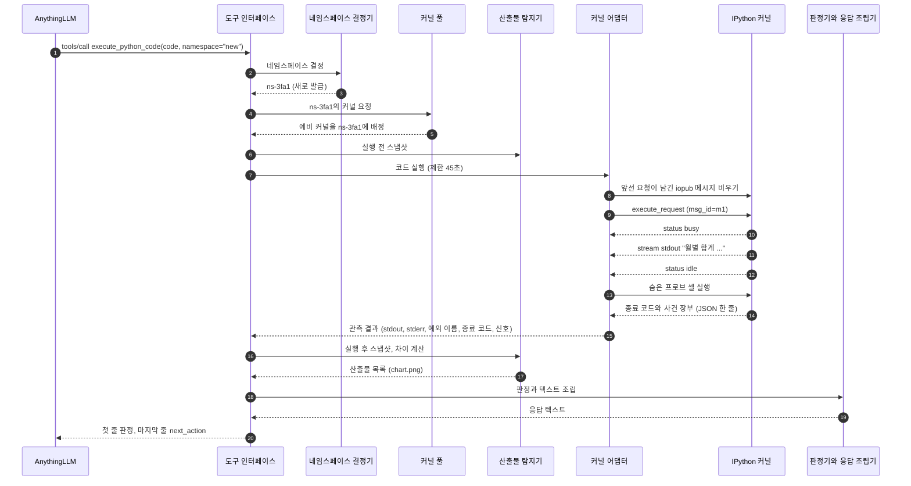
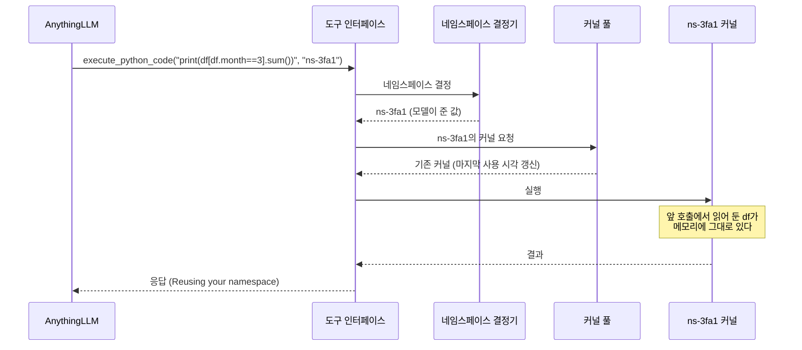
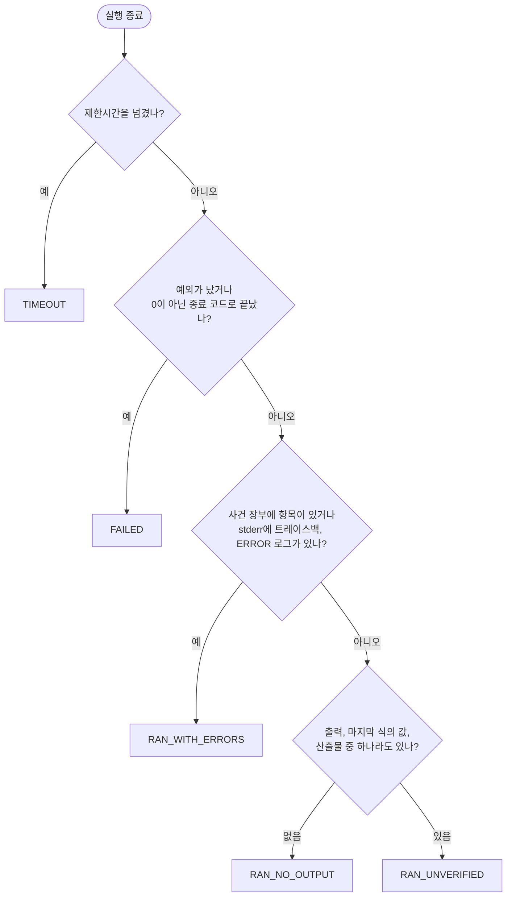
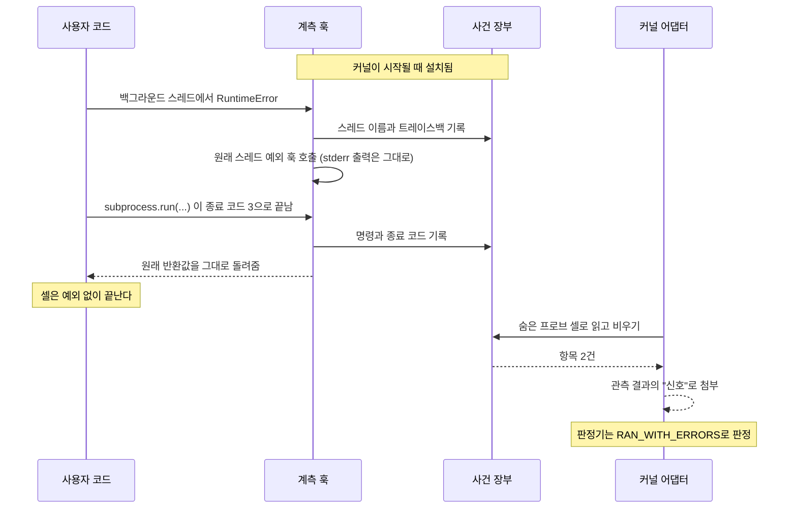
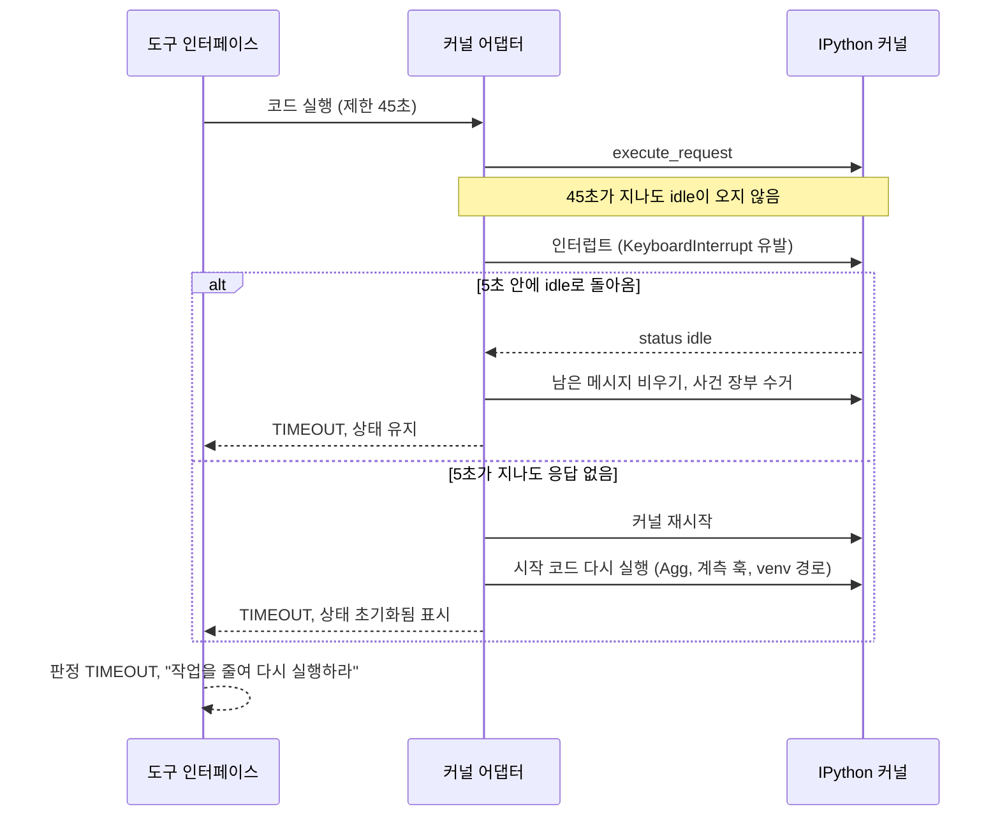
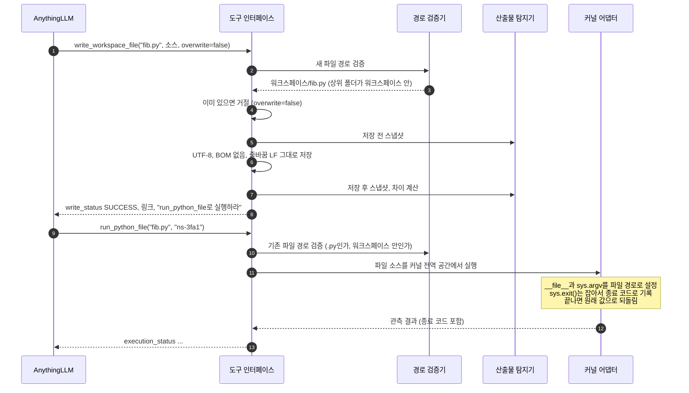
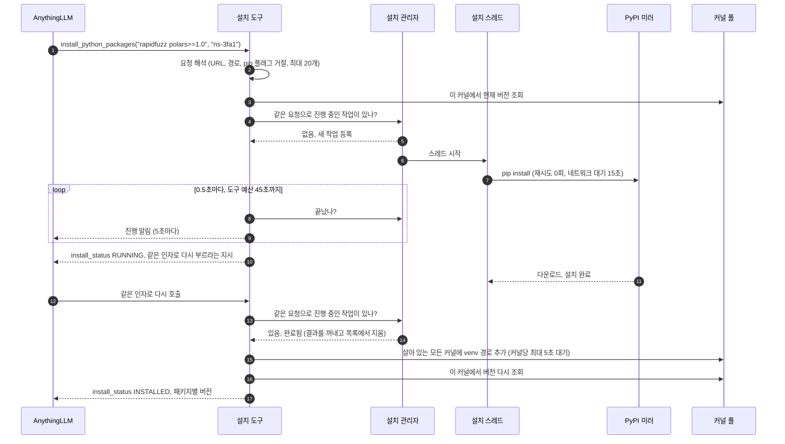
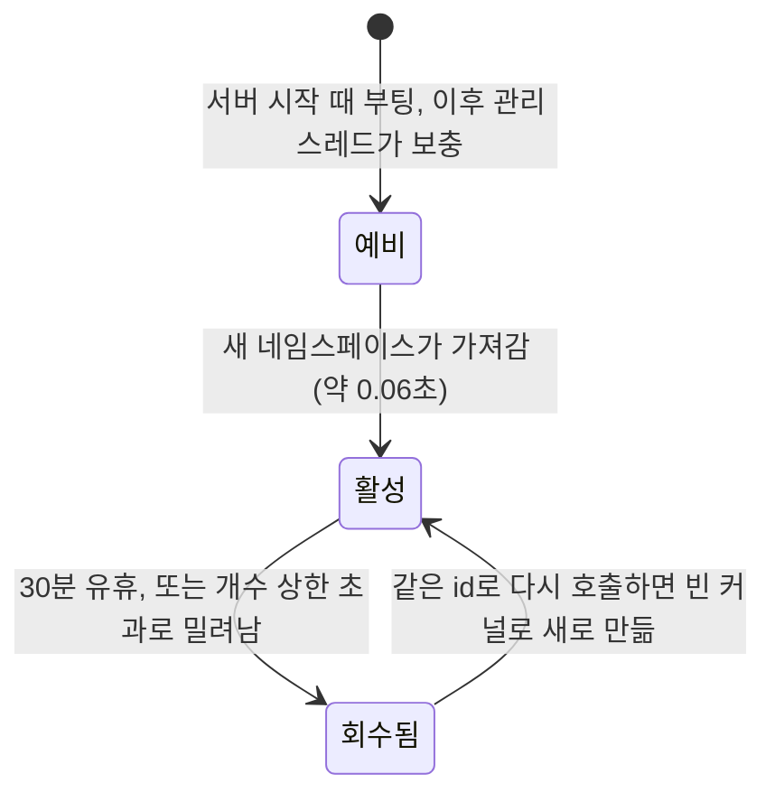
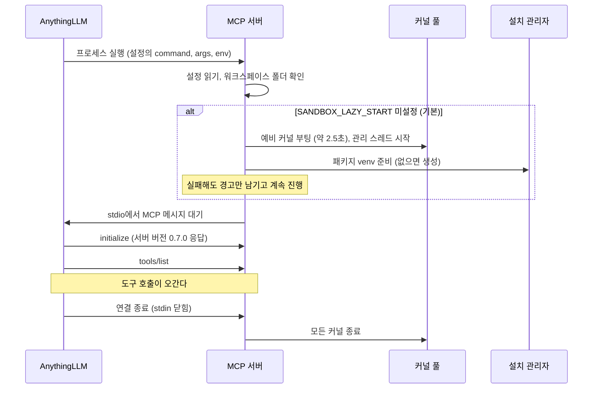

# 3-2. 동적 뷰 (Dynamic View)

정적 뷰가 부품 목록이라면 동적 뷰는 부품들이 실제로 움직이는 장면이다. 이 문서는 시스템에서 일어나는 대표적인 시나리오 여덟 가지를 골라, 누가 어떤 순서로 무엇을 주고받는지 따라간다.

| 시나리오 | 보여 주는 것 |
|---|---|
| 1. 첫 코드 실행 | 가장 기본이 되는 흐름. 네임스페이스 발급부터 응답 조립까지 |
| 2. 후속 질문 | 상태가 유지되는 원리 |
| 3. 판정 | 관측 결과가 등급으로 바뀌는 규칙 |
| 4. 예외 없는 실패의 포착 | 사건 장부가 동작하는 방식 |
| 5. 타임아웃과 복구 | 멈춘 커널을 되살리는 과정 |
| 6. 스크립트 저장 후 실행 | 경로 검증과 스크립트 실행 |
| 7. 패키지 설치 | 시간 예산 안에서 오래 걸리는 작업을 다루는 방법 |
| 8. 네임스페이스와 서버의 생명주기 | 커널이 생기고 사라지는 조건 |

마지막에 이 모든 흐름이 동시에 일어날 때의 규칙(동시성 모델)을 정리한다.

## 1. 첫 코드 실행

사용자가 새 대화에서 "sales.xlsx의 월별 합계를 차트로 그려 줘"라고 했다. 모델은 `execute_python_code`를 `namespace="new"`로 부른다. 먼저 C4 동적 다이어그램으로 큰 흐름을 보자.

같은 흐름을 시퀀스 다이어그램으로 자세히 풀면 다음과 같다.

단계별로 짚어 둘 점이 있다.

**2~3단계, 네임스페이스 발급.** 모델이 `"new"`를 보냈으므로 서버가 `ns-` 뒤에 16진수 네 자리를 붙인 id를 만든다. 지금 살아 있는 네임스페이스와 겹치지 않는지 확인한 뒤 쓴다. 모델이 id를 스스로 지어내게 하지 않는 이유는 [ADR-011](../adr/adr-011-namespace-argument.md)에 있다.

**4~5단계, 예비 커널 배정.** 커널 하나를 부팅하는 데 약 2.5초가 걸린다. 풀은 미리 켜 둔 예비 커널을 새 네임스페이스에 넘겨주므로, 사용자는 이 시간을 기다리지 않는다(약 0.06초). 빈자리는 관리 스레드가 나중에 채운다.

**6단계, 실행 전 스냅샷.** 워크스페이스의 모든 파일에 대해 수정 시각과 크기를 기록한다.

**8단계, 남은 메시지 비우기.** iopub 채널은 방송 채널이라, 앞선 요청이 늦게 흘린 메시지가 남아 있을 수 있다. 새 요청을 보내기 전에 비워 둔다.

**9~12단계, 실행과 수집.** 요청의 `msg_id`에 딸린 메시지만 골라 모은다. 출력은 stdout과 stderr로 나눠 쌓고, 마지막 식의 값이 오면 따로 보관하고, 예외가 오면 예외 이름과 트레이스백을 기록한다. `status: idle`이 오면 끝이다. 제한시간(기본 45초)을 넘기면 5번 시나리오로 넘어간다.

**13~14단계, 프로브.** 사용자 코드가 끝난 직후, 서버는 사건 장부를 읽고 비우는 짧은 셀을 몰래 실행한다. 스크립트가 남긴 종료 코드도 이때 함께 가져온다(4번 시나리오).

**16~17단계, 산출물 계산.** 두 스냅샷을 비교해 새로 생기거나 바뀐 파일을 최신순으로 정리한다. `chart.png`는 이미지이므로 `` 형태가 된다.

**18~20단계, 판정과 조립.** 판정기가 등급을 매기고(3번 시나리오), 조립기가 텍스트를 만든다. 순서는 판정, 네임스페이스 안내, stderr, stdout, 마지막 식의 값, 산출물, 네임스페이스 재안내, 다음 행동 지시다. 판정이 첫 줄, 지시가 마지막 줄에 오는 이유는 [4장](../04-designing-tools-for-llms.md)에서 설명한다.

## 2. 후속 질문

사용자가 이어서 "그중 3월만 따로 보여 줘"라고 한다. 모델은 앞 응답에서 본 `ns-3fa1`을 `namespace`로 넘긴다.

엑셀을 다시 읽지 않는다는 점이 이 시스템의 존재 이유다. 반대로 모델이 `namespace`를 빠뜨리거나 다른 값을 보내면 새 네임스페이스가 만들어지고, `df`가 없다는 `NameError`를 받게 된다. 이것이 네임스페이스 설계의 가장 큰 약점이다.

## 3. 판정

실행이 끝나면 판정기는 관측 결과를 다음 순서로 따져 등급을 정한다. 위에서부터 먼저 걸리는 쪽이 이긴다.

몇 가지 세부 규칙이 있다.

- `sys.exit(0)`이나 인자 없는 `sys.exit()`는 정상 종료로 본다. IPython이 붙이는 "use %tb" 트레이스백 잡음도 지운다.
- stderr 패턴 검사(트레이스백 머리글, `ERROR:`나 `CRITICAL:`로 시작하는 줄)는 예외 없이 끝난 셀에만 적용한다. 예외가 난 셀이라면 그 트레이스백이 이미 보고 대상이기 때문이다.
- stdout에 찍힌 `FAIL` 같은 문자열은 판정에 쓰지 않는다. 일반 출력의 단어로 판정을 바꾸면 오탐이 너무 많다.
- 가장 좋은 판정이 `RAN_UNVERIFIED`다. 서버는 코드가 사용자의 의도대로 동작했는지 확인할 수 없으므로 "성공"이라는 말을 쓰지 않는다([ADR-017](../adr/adr-017-execution-verdict.md)).

## 4. 예외 없는 실패의 포착

v0.5.0 이전에는 예외가 나지 않으면 무조건 성공으로 보고했다. 그런데 실패 중에는 예외를 남기지 않는 것들이 있다. 백그라운드 스레드가 죽거나, 하위 프로세스가 오류 코드로 끝나는 경우다. 셀 자체는 정상적으로 끝나므로 Jupyter 프로토콜로는 `error` 메시지가 오지 않는다. 이를 잡기 위한 장치가 사건 장부다.

프로브는 셀이 실패했을 때도 반드시 실행한다. 장부를 비우지 않으면 남아 있던 항목이 다음 호출의 결과에 붙어 "유령 실패"로 나타나기 때문이다. 이 장치의 비용은 실행마다 커널 왕복 한 번이다. 그래도 남는 틈이 있다. 백그라운드 스레드가 프로브가 끝난 뒤에 죽으면 그 사건은 다음 호출에 귀속된다. 장부 항목에 트레이스백이 그대로 들어 있어 모델이 구분할 수는 있지만, 한 칸 밀려서 보고되는 셈이다.

## 5. 타임아웃과 복구

모델이 무심코 무한 루프를 돌리거나, 너무 큰 데이터를 처리하거나, `time.sleep(600)` 같은 코드를 실행했다고 하자.

인터럽트로 끝나지 않는 경우가 있는 이유는 운영체제에 있다. Windows에서 커널 인터럽트는 파이썬 코드로 도는 루프라면 0.2초 안에 끊지만, `time.sleep`처럼 C 수준에서 한 번 길게 멈춘 호출은 깨우지 못한다. 그래서 유예 시간(5초)이 지나면 커널을 재시작한다. 재시작하면 그 네임스페이스의 변수가 모두 사라지므로 응답에 이 사실을 분명히 적는다. "재시작 경로를 없애면 코드가 깔끔해지지 않을까"라는 유혹이 들 수 있지만, 이것이 커널을 항상 응답 가능하게 지키는 안전망이다([ADR-008](../adr/adr-008-conventional-sandbox-timeouts.md)).

커널이 어떤 이유로든 죽어 있으면, 커널 어댑터는 다음 실행 요청이 왔을 때 먼저 새로 띄운다.

## 6. 스크립트 저장 후 실행

사용자가 "피보나치 합을 구하는 스크립트를 fib.py로 저장하고 실행해 줘"라고 했다. v0.4.0부터 모델은 이를 두 번의 호출로 처리한다.

**저장 쪽 경로 검증.** 아직 파일이 없으므로 상위 폴더를 기준으로 확인한다. 절대 경로와 드라이브 문자, `..`가 들어간 경로, `NUL`·`CON`·`COM1` 같은 Windows 예약 장치 이름을 거절한다. Windows는 이런 이름으로 쓰기를 해도 오류 없이 데이터를 버리기 때문이다. 하위 폴더는 검증을 통과한 뒤에만 만든다. `./workspace/fib.py`처럼 접두사를 붙여도 받아 준다.

**덮어쓰기 거절.** 워크스페이스에는 사용자가 올린 원본 파일도 있다. 실수로 덮어쓰면 복구할 방법이 없으므로 기본값은 거절이다. 거절 메시지는 "`overwrite=true`로 다시 부르거나 다른 이름을 쓰라"고 해결 방법까지 말한다.

**저장 확인.** 실행 도구와 같은 스냅샷 비교를 쓴다. 쓴 파일이 차이에 나타나지 않으면 조용한 실패로 보고 경고한다.

**실행 쪽 경로 검증.** 이미 있는 파일이어야 하고, 실제 위치가 워크스페이스 안이어야 하며, 확장자가 `.py`여야 한다. 이 확인은 커널에 무엇이든 보내기 전에 한다.

**스크립트 의미론.** 파일의 소스를 커널의 전역 공간에서 바로 실행한다. IPython의 전역 공간은 이미 이름이 `__main__`이므로 `if __name__ == "__main__":` 블록이 돈다. 이름은 바인딩되는 순간 전역 공간에 남으므로, 스크립트가 `sys.exit(main())`으로 끝나거나 중간에 예외가 나도 그때까지 정의된 함수와 변수는 다음 호출에서 쓸 수 있다([ADR-010](../adr/adr-010-run-script-file.md)).

## 7. 패키지 설치

모델이 `import rapidfuzz`에서 실패하자 설치 도구를 부른다. 미러에서 휠을 받는 데 1분이 넘게 걸린다고 해 보자. 클라이언트는 60초가 지나면 요청을 포기하므로, 서버는 45초 안에 무엇이든 답해야 한다.

이 흐름에는 몇 가지 장치가 겹쳐 있다.

**작업 합류.** 설치 작업은 패키지 목록을 정렬한 문자열을 열쇠로 등록된다. 모델이 같은 목록을 다시 보내면 새 pip을 띄우지 않고 기존 작업에 합류한다. 그래서 "같은 인자로 다시 부르라"고 모델에게 안전하게 말할 수 있다. 결과를 꺼내면 등록을 지우므로 나중에 같은 설치를 다시 할 수도 있다. 여러 설치 스레드가 떠도 실제 pip 실행은 락으로 한 번에 하나씩 돈다.

**지름길.** 요청한 이름이 모두 버전 지정 없이 적혀 있고 이미 import할 수 있다면 pip을 아예 부르지 않는다. 모델이 반사적으로 pandas를 "설치"하려 할 때 미러까지 다녀오는 낭비를 막는다.

**모든 커널에 반영.** 설치가 끝나면 venv의 패키지 폴더를 살아 있는 모든 커널의 검색 경로에 붙인다. 재시작하지 않으므로 다른 대화가 불러 둔 데이터가 살아남는다. 다만 긴 셀을 돌리고 있는 커널을 기다리느라 도구 예산을 써 버리면 안 되므로, 커널마다 최대 5초만 기다리고 포기한다. 포기한 네임스페이스는 응답에 적어 두며, 그 커널은 다음에 시작할 때 경로를 자동으로 받는다.

**설치 확인.** pip이 0으로 끝났다는 사실만으로 `INSTALLED`라 하지 않는다. 커널에게 직접 각 배포판의 버전을 물어 모두 답이 와야 `INSTALLED`다.

설치에 실패하면 설치 관리자는 pip의 출력만 믿지 않고 원인을 가린다.

"인덱스에 닿지 않는다"로 판정할 때, pip이 실제로 쓴 인덱스가 공개 PyPI 주소라면 "이 PC에는 미러가 설정되지 않았다"고 한 번 더 분명히 말한다. 새 PC에서 가장 흔한 실수가 바로 이것이기 때문이다. 자세한 배경은 [ADR-020](../adr/adr-020-verify-installs-directly.md)과 [ADR-021](../adr/adr-021-tool-time-budget.md)에 있다.

## 8. 네임스페이스와 서버의 생명주기

### 8.1 커널 하나의 일생

그림에 다 담지 못한 전이가 몇 가지 있다. 예비 커널이 없을 때 새 네임스페이스가 생기면 그 자리에서 커널을 부팅한다(약 2.5초). 활성 상태의 커널은 실행할 때마다 마지막 사용 시각이 갱신되고, `reset_kernel_state`나 타임아웃 뒤의 강제 재시작을 거쳐도 활성 상태에 머문다. 이때는 프로세스만 새로 뜨고 메모리가 비워질 뿐, 네임스페이스와의 연결은 유지된다. "개수 상한 초과"란 이미 8개가 살아 있는데 새 네임스페이스가 필요해져 가장 오래 쉰 것부터 밀려나는 경우다.

관리 스레드는 30초마다 깨어나 두 가지 일을 한다. 30분(`SANDBOX_NS_IDLE_TIMEOUT`) 넘게 쓰지 않은 네임스페이스의 커널을 종료하고, 예비 커널이 없으면 새로 부팅해 채운다. 부팅은 느리므로 풀의 락을 잡지 않은 채로 하고, 다 뜬 뒤에 짧게 락을 잡아 자리에 넣는다.

회수는 조용히 일어난다. 30분 쉬었다가 같은 id로 돌아온 모델은 "Reusing your namespace"라는 안내를 받지만 커널은 새것이다. 불러 둔 데이터가 없어졌다는 사실은 `NameError`를 보고서야 알게 된다.

### 8.2 서버의 기동과 종료

기동할 때 예비 커널을 미리 띄우는 데는 두 가지 목적이 있다. 첫 호출을 빠르게 하는 것, 그리고 포터블 Python 경로가 틀렸다거나 ipykernel이 없다는 설정 오류를 대화 도중이 아니라 서버를 켤 때 드러내는 것이다. venv를 기동 시점에 만드는 이유는 v0.7.0에서 생겼다. 포터블 Python에서 venv를 만드는 데 수십 초가 걸릴 수 있는데, 이를 첫 설치 호출 안에서 치르다가 클라이언트 제한시간을 넘긴 일이 있었다.

## 9. 동시성 모델

지금까지의 흐름이 동시에 일어날 때 지켜지는 규칙을 모으면 다음과 같다.

| 대상 | 규칙 | 이유 |
|---|---|---|
| 커널 하나 | 모든 조작(실행, 프로브, 재시작, 경로 추가)을 커널별 재진입 락 안에서 한다 | 두 요청이 같은 메시지 채널을 번갈아 읽으면 출력이 섞인다 |
| 서로 다른 커널 | 서로 막지 않는다 | 한 대화의 긴 셀이 다른 대화를 멈추면 안 된다 |
| 커널 풀의 대응표 | 풀 락으로 보호하되, 느린 커널 부팅은 락 밖에서 한다 | 예비 보충이 다른 호출을 붙잡지 않게 |
| 설치 작업 등록부 | 별도 락으로 보호. 같은 요청은 한 작업으로 합친다 | "다시 부르라"는 지시가 중복 설치를 낳지 않게 |
| pip 실행 | 한 번에 하나 | 같은 venv에 두 pip이 동시에 쓰지 않게 |
| 설치 후 경로 반영 | 커널마다 최대 5초만 락을 기다린다 | 남의 긴 셀 때문에 도구 예산을 다 쓰지 않게 |
| 산출물 탐지 | 커널 락 밖에서, 공유 워크스페이스 전체를 대상으로 한다 | 두 대화가 정확히 동시에 실행되면 상대의 파일이 내 산출물로 잡힐 수 있다. 한 사용자가 한 번에 한 대화를 쓰는 패턴에서는 받아들일 만한 위험으로 판단했다([ADR-013](../adr/adr-013-shared-workspace.md)) |

## 생각해 볼 문제

1. 1번 시나리오에서 스냅샷을 커널 락 안에서 찍도록 바꾸면 산출물 오귀속 문제가 해결될까? 해결되지 않는다면 무엇이 더 필요할까?
2. 타임아웃 시 인터럽트 없이 바로 재시작하면 코드가 단순해진다. 5초 유예를 두는 쪽이 사용자에게 주는 이점은 무엇인가?
3. 설치 도구가 `RUNNING`을 돌려준 뒤 모델이 다시 부르지 않으면 어떻게 될까? 설치는 끝났지만 결과를 아무도 거두지 않은 작업은 어떤 문제를 남기는가?
4. 8.1의 "조용한 회수"를 모델에게 알려 주려면 응답의 어느 자리에 무엇을 추가하면 좋을까?
