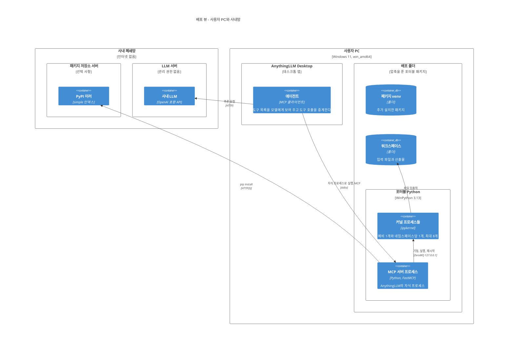
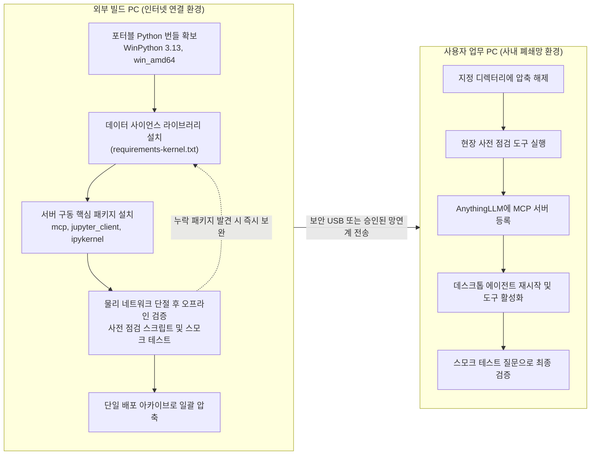

# 3-3. 배포 뷰 (Deployment View)

배포 뷰(Deployment View)는 소프트웨어를 구성하는 프로세스와 파일들이 실제 물리 머신과 파일시스템의 어디에 배치되어 구동되는지를 다룹니다. 본 에어갭 샌드박스 시스템에서는 배포 뷰가 시스템 설계의 성패를 가를 만큼 대단히 중요합니다. 외부 인터넷 연결이 완전히 차단된 사내 폐쇄망 PC에 복잡한 Python 데이터 사이언스 환경을 안전하게 "반입하고 설치"하는 엔지니어링 과정 자체가 프로젝트 전체 과업의 절반을 차지하기 때문입니다.

본 문서는 두 가지 핵심 장면으로 나누어 살펴봅니다. 첫째는 사용자 PC 내부에서 프로세스와 디렉터리들이 자리 잡고 동작하는 모습(런타임 배치)이며, 둘째는 인터넷이 연결된 외부 빌드 PC에서 패키지 번들을 빌드하여 폐쇄망 PC로 안전하게 이송하는 과정(빌드와 반입)입니다. 이어서 환경 변수 설정 명세, 보안 경계의 현실적인 한계, 그리고 배포 이후의 일상적인 유지보수 운영 절차를 차례로 설명해 드립니다.

## 1. 대상 배포 환경의 구분

| 배포 환경 | 네트워크 상태 | 환경의 핵심 역할 및 사양 |
|---|---|---|
| 빌드 PC | 외부 인터넷 연결 활성화 | 포터블 Python 런타임에 데이터 분석 패키지들을 설치하고 오프라인 검증을 마친 뒤 배포 패키지 번들을 빌드합니다. |
| 사용자 PC (타깃 호스트) | 사내 폐쇄망에만 연결 (인터넷 차단) | AnythingLLM 데스크톱 앱과 본 샌드박스 서버가 실제로 구동되는 실무 업무용 PC입니다. (Windows 11 64비트 환경) |
| 사내 LLM 중앙 서버 | 사내 폐쇄망 내부 상주 | 고성능 언어 모델 추론을 제공하는 중앙 서버입니다. 실무 사용자에게 시스템 관리자 권한은 일절 부여되지 않습니다. |
| 사내 PyPI 미러 서버 | 사내 폐쇄망 내부 상주 | (선택적 연동) 사내망 내부에 패키지 미러가 구축되어 있을 경우, 런타임에 추가 패키지를 동적 설치하는 저장소로 활용합니다(v0.6.0 이후). |

여기서 가장 중요한 점은 빌드 PC와 사용자 업무용 PC 사이에 어떠한 네트워크 연결도 존재하지 않는다는 사실입니다. 두 환경 사이는 물리 보안 심의를 통과한 암호화 USB 드라이브나 사내 전용 승인 망연계 전송 시스템과 같은 엄격한 오프라인 절차를 통해서만 연결됩니다.

## 2. 런타임 배치 구조

### 2.1 C4 배포 다이어그램



### 2.2 프로세스 트리 계층 구조

사용자 PC 내부에서 실행되는 프로세스들은 다음과 같은 명확한 부모-자식 트리 계층을 형성합니다.

```
AnythingLLM.exe
 └─ python.exe  (MCP 서버 메인 프로세스, 표준 입출력 stdio 파이프로 부모와 통신)
     ├─ python.exe -m ipykernel_launcher  (사전 워밍업된 예비 커널)
     ├─ python.exe -m ipykernel_launcher  (활성 세션 커널: ns-3fa1)
     ├─ python.exe -m ipykernel_launcher  (활성 세션 커널: ns-9c07)
     │   ...                               (활성 커널 최대 8개)
     └─ python.exe -m pip install ...      (패키지 설치 요청 시에만 임시 생성되는 venv의 pip)
```

AnythingLLM은 설정 파일에 등록된 `command`와 `args` 경로를 기반으로 MCP 서버 프로세스를 직접 구동합니다. 따라서 MCP 서버는 AnythingLLM의 직속 자식 프로세스가 되며, AnythingLLM 앱이 종료되면 OS 시그널에 의해 자식 프로세스인 서버도 함께 안전하게 종료됩니다. 서버는 종료되는 과정에서 자신이 생성했던 하위 IPython 커널 프로세스들을 모두 깨끗이 정리합니다. 각 커널을 띄우는 데 사용되는 Python 인터프리터 경로는 `SANDBOX_KERNEL_PYTHON` 환경 변수에 의해 결정되며, 기본 배포 패키지에서는 서버 자신과 동일한 WinPython 인터프리터를 공유합니다.

시스템이 가동 중인 특정 시점에 존재할 수 있는 Python 프로세스의 최대 총수는 메인 서버 1개, 활성 세션 커널 최대 8개, 예비 커널 1개, 그리고 패키지 설치 시 일시적으로 뜨는 pip 프로세스 1개를 포함하여 **동시에 최대 11개**입니다.

### 2.3 메모리 사용량 산정 및 튜닝 전략

본 시스템이 소비하는 OS 메모리의 거의 대부분은 백엔드 Jupyter 커널 프로세스들로부터 발생합니다. IPython 커널 프로세스 하나는 아무런 연산을 수행하지 않은 초기 유휴 상태에서도 수십 MB의 기본 메모리를 점유하며, 사용자의 대화가 진행됨에 따라 로드된 대용량 엑셀이나 데이터프레임의 크기만큼 메모리 사용량이 정비례하여 증가합니다. 만약 서로 다른 세 개의 대화 세션에서 동일한 500MB 크기의 엑셀 파일을 각각 로드했다면 약 1.5GB 이상의 메모리가 독립적으로 소모됩니다. 이것이 바로 세션 간 상태 오염을 원천 차단하기 위해 지불하는 완벽한 메모리 격리의 비용입니다.

시스템 관리자는 이 메모리 소비량을 통제할 수 있는 두 가지 핵심 환경 변수 레버를 제공받습니다.
- **최대 동시 유지 네임스페이스 수 (`SANDBOX_MAX_NAMESPACES`)**: 기본값 8개
- **유휴 세션 회수 타임아웃 (`SANDBOX_NS_IDLE_TIMEOUT`)**: 기본값 1800초 (30분)

만약 8GB나 16GB 수준의 메모리가 다소 빠듯한 PC 환경이라면, 최대 네임스페이스 상한을 3~4개 수준으로 낮추고 유휴 회수 시간을 10분(600초) 정도로 축소하여 설정하시면 메모리 부족 현상을 효과적으로 방지할 수 있습니다. 다만 이 경우 회수된 오래된 대화 창에서 다시 질문을 던질 때 데이터를 메모리로 다시 로드해야 하는 트레이드오프가 발생합니다.

### 2.4 네트워크 인바운드 및 아웃바운드 특성

사용자 PC에서 외부로 나가는 아웃바운드 네트워크 연결은 다음 두 가지로 완벽히 국한됩니다.
- AnythingLLM 앱에서 사내 LLM 중앙 서버로 향하는 HTTP 추론 요청
- 패키지 동적 설치 시 pip 모듈이 사내 PyPI 미러 서버로 전송하는 HTTP/HTTPS 요청 (설치 도구 실행 시에만 한시적 동작)

가장 중요한 보안 특성은 **외부로부터 들어오는 인바운드 네트워크 연결을 수신하기 위한 개방 포트(Port)가 시스템 전체에 단 하나도 존재하지 않는다**는 점입니다. AnythingLLM과 MCP 서버 간의 통신은 OS 표준 입출력(stdio) 파이프로 이루어지며, MCP 서버와 Jupyter 커널 간의 통신 역시 오직 로컬 루프백(`127.0.0.1`) 인터페이스만을 엄격히 사용합니다. 따라서 네트워크 침입 경로나 외부 공격 표면(Attack Surface)이 원천적으로 차단되어 있습니다.

## 3. 오프라인 배포 패키지 디렉터리 구조

사용자 PC에 압축 해제된 최종 배포 번들의 디렉터리 배치는 다음과 같습니다.

```
AirGappedPySandbox\                 압축 해제 루트 디렉터리 (이하 <BASE>)
├─ PACKAGE_INFO.txt                 패키지 상세 개요 및 빠른 시작 안내서
├─ BUILD_PORTABLE_PACKAGE.md        오프라인 패키지 빌드 매뉴얼
├─ WPy64-313130\                    완전 독립형 포터블 Python (WinPython 3.13, 전체 필수 라이브러리 내장)
│   └─ python\python.exe            실제 실행 인터프리터 바이너리
└─ mcp-server\                      샌드박스 서버 소스 코드 및 부속 환경
    ├─ (서버 핵심 모듈, 사전 점검 도구, 스모크 테스트 스크립트)
    ├─ requirements-server.txt      서버 구동 필수 의존성 목록 (mcp, jupyter_client, ipykernel)
    ├─ requirements-kernel.txt      기본 내장 데이터 사이언스 라이브러리 목록
    ├─ anythingllm_mcp_config.example.json  클라이언트 등록용 설정 예제
    ├─ install_offline.ps1          오프라인 휠 기반 환경 설치 스크립트
    ├─ start_server.ps1             수동 디버깅 실행용 PowerShell 스크립트
    ├─ offline_wheels\              서버 구동용 오프라인 바이너리 휠 69개 (Python 3.11~3.13 호환)
    ├─ workspace\                   사용자 파일 업로드 및 분석 산출물 공유 작업 폴더
    └─ .sandbox-venv\               동적 추가 설치 패키지 전용 사이드 venv (서버 최초 기동 시 자동 생성)
```

전체 배포 아카이브의 압축 해제 용량은 약 3.47GB에 달하며, 이 용량의 95% 이상은 `WPy64-313130` 포터블 Python 디렉터리가 차지합니다. Git 소스 코드 저장소에는 대용량 바이너리인 WinPython 폴더나 휠 아카이브를 커밋하지 않으며, CI 빌드 머신이나 외부 작업 PC에서 빌드 스크립트를 통해 생성하도록 분리되어 있습니다.

## 4. 오프라인 빌드와 안전한 반입 절차

### 4.1 엔드투엔드 반입 파이프라인



### 4.2 외부 빌드 PC에서의 작업 수칙

**첫째, 대상 OS 플랫폼 아키텍처를 완벽히 일치시켜야 합니다.** 빌드를 수행하는 머신의 운영체제 버전, CPU 아키텍처 비트 수(64비트), 그리고 Python의 마이너 버전이 실제 사용자 PC와 정확히 일치해야 합니다. numpy, scipy, PyMuPDF와 같이 C/C++ 네이티브 바이너리를 내장한 패키지들은 플랫폼마다 바이너리 형식이 엄격히 다릅니다. 이 규격이 맞지 않으면 폐쇄망 PC에서 실행 시 "지원되지 않는 휠 플랫폼" 오류를 내며 완전히 동작하지 않습니다.

**둘째, 두 가지 종속성 요구 목록을 포터블 런타임에 빠짐없이 설치합니다.** `requirements-kernel.txt`에 명시된 약 30종의 데이터 분석 패키지와 `requirements-server.txt`에 명시된 서버 핵심 모듈들을 동일한 포터블 Python 환경에 일괄 설치합니다. 이렇게 두 환경을 단일 런타임에 통합 설치해 두면 서버와 커널이 동일한 인터프리터를 공유하게 되므로 폐쇄망 현장에서 별도의 복잡한 경로 설정 작업이 필요 없습니다.

**셋째, 외부 인터넷 케이블을 물리적으로 분리한 뒤 완전한 오프라인 상태에서 사전 검증을 수행합니다.** 폐쇄망 환경에서 발생할 수 있는 잠재적 결함을 미리 식별하기 위해서는 반드시 현장과 100% 동일한 오프라인 조건에서 테스트해야 합니다. 제공되는 사전 점검 도구(`check_env.py`)를 실행하여 필수 및 권장 패키지의 존재 여부를 검사하고, 실제로 커널 프로세스를 띄워 코드 실행 테스트를 진행합니다. 최종 판정 결과가 반드시 `RESULT: PASS`로 확인되어야 합니다. 만약 특정 필수 패키지가 누락(MISS)된 것으로 나타나면 반드시 인터넷이 연결된 빌드 PC에서 즉시 추가 설치하여 해결해야 합니다. 인터넷이 없는 현장에서는 이를 해결할 방법이 없기 때문입니다.

**넷째, 불필요한 캐시 파일들을 깨끗이 정제한 후 압축합니다.** 워크스페이스 내의 임시 테스트 파일, Python 바이트코드 캐시 디렉터리(`__pycache__`), 그리고 개발 과정에서 생성된 임시 가상환경들은 아카이브에 포함되지 않도록 말끔히 정리한 뒤 단일 ZIP 파일로 압축합니다.

### 4.3 사용자 폐쇄망 PC에서의 배포 및 검증 절차

사내 보안 절차를 통해 번들을 반입한 후, 사용자는 원하는 로컬 경로(예: `C:\AirGappedPySandbox`)에 압축을 해제합니다. 이어서 터미널을 열고 사전 점검 도구를 다시 한번 실행하여 해당 PC 환경에서도 `RESULT: PASS`가 정상 출력되는지 최종 확인합니다. 점검이 통과되면 AnythingLLM 설정 메뉴에 MCP 서버를 등록하고(5.1절 참조), 에이전트 기능을 활성화합니다. 마지막으로 채팅창에 "x·sin(x) 함수를 0부터 π까지 정적분하고 그 결과를 그래프 차트로 그려서 저장해 줘"라는 테스트 질문을 전송하여, 정확한 수치 계산 답변과 함께 차트 이미지 링크가 정상적으로 출력되는지 확인하시면 모든 배포 과정이 성공적으로 완료됩니다.

### 4.4 경량 반입 시나리오 (Lightweight Delivery)

만약 사용자 PC에 이미 데이터 사이언스 라이브러리가 충분히 갖춰진 사내 표준 Python 환경이 사전에 설치되어 있다면, 3.47GB에 달하는 대용량 번들을 매번 옮길 필요 없이 샌드박스 서버 소스 코드와 `offline_wheels` 디렉터리(수십 MB)만을 가볍게 반입하는 경량 배포 방식을 적용할 수 있습니다. 번들에 포함된 오프라인 설치 스크립트(`install_offline.ps1`)는 외부 인터넷 인덱스를 조회하지 않고 로컬 휠 디렉터리만을 바라보도록 명령하여(`pip install --no-index --find-links offline_wheels`) 서버 필수 의존성을 순식간에 설치합니다. 이 아카이브에는 Python 3.11, 3.12, 3.13용 바이너리가 모두 구비되어 있으므로 대상 Python 버전에 최적화된 휠이 자동으로 선택됩니다. 설령 대상 Python 환경이 읽기 전용으로 잠겨 있어 패키지 추가가 불가능하더라도, 서버 프로세스 자체는 별도의 일반 Python으로 구동하고 커널 인터프리터 경로(`SANDBOX_KERNEL_PYTHON`)만 해당 고정 환경을 바라보도록 유연하게 분리 구성할 수 있습니다([ADR-003](../adr/adr-003-separate-interpreters.md)).

## 5. 시스템 환경 설정 명세

### 5.1 AnythingLLM MCP 서버 등록 규격

AnythingLLM의 MCP 서버 설정 파일(`desktop_mcp_servers.json`) 또는 GUI 설정 메뉴(Settings → Agent Skills → MCP Servers)에 다음과 같이 서버 정보를 등록합니다. 여기서 `<BASE>` 표기는 번들의 실제 절대 압축 해제 경로(예: `D:\\AirGappedPySandbox`)로 치환하여 입력합니다.

```jsonc
{
  "mcpServers": {
    "air-gapped-python-sandbox": {
      "command": "<BASE>\\WPy64-313130\\python\\python.exe",
      "args": ["<BASE>\\mcp-server\\server.py"],
      "env": {
        "SANDBOX_KERNEL_PYTHON": "<BASE>\\WPy64-313130\\python\\python.exe",
        "SANDBOX_WORKSPACE": "<BASE>\\mcp-server\\workspace",
        "SANDBOX_EXEC_TIMEOUT": "45",
        "SANDBOX_PIP_INDEX_URL": "http://pypi-mirror.example.local/simple",
        "SANDBOX_PIP_TRUSTED_HOST": "pypi-mirror.example.local"
      }
    }
  }
}
```

사내망에 패키지 미러 서버가 구축되지 않은 환경이라면 위 설정 중 마지막 두 줄(`SANDBOX_PIP_INDEX_URL`, `SANDBOX_PIP_TRUSTED_HOST`)을 완전히 생략하셔도 무방합니다. 이 경우 패키지 동적 설치 도구는 "미러 서버가 구성되지 않았음"을 이유로 안전하게 거절되며, 나머지 모든 핵심 기능은 100% 정상 작동합니다.

> [!NOTE]
> v0.7.0 릴리스 직후 배포된 일부 구형 예제 파일에는 `SANDBOX_EXEC_TIMEOUT` 기본값이 과거 기준인 `60`으로 기재되어 있었습니다. 만약 과거 예제를 복사하여 설정한 PC가 있다면 이 값을 반드시 **45** 이하로 수정해 주시기 바랍니다. 그 구체적인 이유는 5.3절에서 자세히 설명합니다.

### 5.2 상세 환경 변수 명세

시스템의 모든 동작 파라미터는 OS 환경 변수를 통해 커스터마이징할 수 있으며, 변수가 선언되지 않은 경우 안정적인 기본값이 자동 적용됩니다.

**경로 관련 설정**

| 환경 변수명 | 기본 적용값 | 설정의 의미와 역할 |
|---|---|---|
| `SANDBOX_KERNEL_PYTHON` | 서버 프로세스 자신의 Python 경로 | 백엔드 Jupyter 커널 프로세스들을 생성할 Python 인터프리터의 실행 파일 경로입니다. |
| `SANDBOX_WORKSPACE` | `<BASE>/mcp-server/workspace` | 사용자 입력 파일 및 코드 분석 산출물이 저장되는 작업 디렉터리이자 커널의 작업 디렉터리(cwd)입니다. |
| `SANDBOX_VENV` | `<BASE>/mcp-server/.sandbox-venv` | 사내 미러로부터 추가 설치된 패키지가 격납되는 사이드 venv 디렉터리입니다. 절대 워크스페이스 내부에 위치해서는 안 됩니다. |

환경 변수에 상대 경로를 지정할 경우 임의의 현재 디렉터리가 아닌, MCP 서버 진입점 소스코드가 위치한 디렉터리를 기준으로 절대 경로화됩니다. 이를 통해 호스트 런처가 서버를 어떤 작업 폴더에서 구동하더라도 항상 동일한 설정 디렉터리를 정확히 참조하도록 보장합니다.

**시간 예산 및 타임아웃 설정**

| 환경 변수명 | 기본 적용값 | 설정의 의미와 역할 |
|---|---|---|
| `SANDBOX_TOOL_BUDGET` | 45초 | 단일 도구 호출 요청이 클라이언트에 최종 응답을 반환하기까지 허용되는 최대 시간 예산입니다. |
| `SANDBOX_EXEC_TIMEOUT` | 45초 | 단일 코드 블록 실행 시 허용되는 최대 인터프리터 연산 시간입니다. |
| `SANDBOX_STARTUP_TIMEOUT` | 60초 | 커널 프로세스의 초기 부팅 및 ZeroMQ 핸드셰이크를 대기하는 최대 허용 시간입니다. |
| `SANDBOX_NS_IDLE_TIMEOUT` | 1800초 (30분) | 특정 네임스페이스에 호출이 없을 때 메모리에서 유휴 커널을 안전하게 회수하기까지의 대기 시간입니다. |
| `SANDBOX_PIP_TIMEOUT` | 300초 (5분) | 단일 백그라운드 패키지 설치 작업에 허용되는 최대 소요 시간입니다. |
| `SANDBOX_PIP_NETWORK_TIMEOUT` | 15초 | pip 프로세스가 사내 미러 서버의 초기 네트워크 응답을 대기하는 소켓 타임아웃 시간입니다. |
| `SANDBOX_VENV_CREATE_TIMEOUT` | 180초 (3분) | 사이드 가상환경(venv) 디렉터리를 최초 생성할 때 허용되는 최대 소요 시간입니다. |

**용량 및 동시성 제한 설정**

| 환경 변수명 | 기본 적용값 | 설정의 의미와 역할 |
|---|---|---|
| `SANDBOX_MAX_STREAM_CHARS` | 20,000자 | LLM 컨텍스트 폭주를 막기 위해 도구가 반환하는 stdout 및 stderr의 최대 문자 수입니다. (0 지정 시 무제한) |
| `SANDBOX_MAX_WRITE_BYTES` | 1,048,576바이트 (1MB) | 파일 저장 도구(`write_workspace_file`)로 한 번에 디스크에 기록할 수 있는 최대 파일 크기입니다. |
| `SANDBOX_MAX_NAMESPACES` | 8개 | 시스템 전체에서 메모리에 동시에 유지할 수 있는 최대 활성 세션 네임스페이스 커널의 개수입니다. |
| `SANDBOX_MAX_PACKAGES_PER_CALL` | 20개 | 단일 설치 도구 호출에서 한 번에 요청할 수 있는 최대 패키지 목록의 개수입니다. |
| `SANDBOX_PIP_RETRIES` | 0회 | 사내 미러 연결 실패 시 pip의 재시도 횟수입니다. (불필요한 타임아웃 누적을 막기 위해 0으로 고정) |

**동작 모드 설정**

| 환경 변수명 | 기본 적용값 | 설정의 의미와 역할 |
|---|---|---|
| `SANDBOX_LAZY_START` | 미설정 (false) | `true`로 설정할 경우 서버 최초 기동 시 예비 커널 부팅과 venv 사전 생성을 건너뛰고 첫 요청 시 지연 생성합니다. |
| `SANDBOX_PIP_INDEX_URL` | 미설정 | 사내 PyPI 미러 서버의 패키지 인덱스 엔드포인트 URL입니다. |
| `SANDBOX_PIP_TRUSTED_HOST` | 미설정 | 사내 미러 서버가 비보안 HTTP 주소를 사용할 경우 SSL 검증을 우회하기 위한 호스트 도메인 명칭입니다. |

### 5.3 시간 예산(Timeout Budget) 간의 엄격한 상호 관계

시스템을 안정적으로 운영하기 위해서는 시간 관련 파라미터들이 결코 독립적으로 설정되어서는 안 되며, 다음 부등식 관계가 엄격히 유지되어야 합니다.

```
코드 실행 타임아웃 (SANDBOX_EXEC_TIMEOUT: 45초)
  ≤ 도구 허용 시간 예산 (SANDBOX_TOOL_BUDGET: 45초)
  < 클라이언트 강제 취소 제한 시간 (AnythingLLM: 60초)
```

코드 실행이 45초 제한 시간에 도달하면 커널 인터럽트 신호가 전송되고, 프로세스 반응을 위해 최대 5초의 안전 유예 시간이 추가로 소요되며, 이후 최종 파일 스냅샷과 프로브 셀 수거 과정이 이어집니다. 따라서 실행 제한을 45초로 설정해 두어야만 최악의 지연 상황에서도 클라이언트의 60초 강제 취소 타임아웃이 발생하기 전에 서버가 정돈된 `TIMEOUT` 판정 응답을 클라이언트에 안전하게 전달할 수 있습니다. 만약 실행 제한을 클라이언트와 동일한 60초로 설정해 버리면, 서버의 타임아웃 복구 응답과 클라이언트의 강제 연결 중단 중 어느 쪽이 먼저 발생할지 예측할 수 없는 심각한 레이스 컨디션이 발생합니다. 만약 더 긴 연산 시간이 불가피하게 필요하다면, MCP 서버 설정뿐만 아니라 AnythingLLM 클라이언트 소스 레벨의 요청 타임아웃 제한까지 함께 상향 조정해야 합니다([ADR-021](../adr/adr-021-tool-time-budget.md)).

## 6. 보안 경계와 관습적 샌드박스의 한계

본 샌드박스는 OS 레벨의 완전 격리 가상화 감옥이 아니며, 일반 사용자 권한 범위 내에서 동작하는 "관습적 샌드박스(Conventional Sandbox)" 모델을 따릅니다. 시스템을 현장에 배포하고 운영할 때 이러한 보안 경계의 보장 범위와 명확한 한계를 반드시 이해하고 계셔야 합니다.

| 보안 통제 대상 | 차단 여부 | 상세 동작 방식 및 보안 한계 |
|---|---|---|
| 파일 도구(저장, 스크립트 실행)의 워크스페이스 경계 탈출 | 완벽히 차단됨 | 서버의 경로 검증기(Path Guard)가 상위 폴더 탈출(`..`) 및 절대 경로를 즉각 거절합니다. |
| 모델이 작성한 임의 코드가 워크스페이스 외부 파일을 직접 조작 | 차단되지 않음 | 코드는 현재 로그인된 사용자의 OS 계정 권한으로 그대로 실행됩니다. 워크스페이스 사용은 도구 설명문 및 시스템 프롬프트 규칙으로 유도할 뿐 OS 레벨에서 강제하지 못합니다. |
| 실행 코드가 사내망 내부의 다른 호스트로 네트워크 요청 전송 | 차단되지 않음 | "네트워크 호출 금지"는 도구 설명문의 지침일 뿐이며, 코드가 소켓 통신을 시도할 경우 OS 레벨에서 이를 직접 막지 않습니다. |
| 실행 코드가 외부 공용 인터넷으로 데이터를 유출 | 완벽히 차단됨 | 소프트웨어 샌드박스가 막는 것이 아니라, 대상 PC가 위치한 물리적 사내 폐쇄망 인프라 자체가 외부 연결을 100% 원천 차단합니다. |
| 무한 루프나 멈춘 코드가 시스템 프로세스를 영구 점유 | 완벽히 차단됨 | 엄격한 시간 예산 감시, 인터럽트 신호 전송, 그리고 프로세스 강제 킬(Kill) 및 재기동 메커니즘을 통해 완벽히 방어합니다. |
| 대량 출력 폭주로 인한 LLM 컨텍스트 윈도우 오염 | 완벽히 차단됨 | `SANDBOX_MAX_STREAM_CHARS` 상한 필터를 통해 초과된 출력 문자열을 안전하게 절삭(Truncate)합니다. |

만약 사내망 내부 접근까지 철저히 격리하는 시스템 수준의 강력한 보안 샌드박스가 필요하다면, 서버 전체를 네트워크 네임스페이스가 격리된 Docker 컨테이너나 권한이 엄격히 박탈된 별도의 전용 서비스 OS 계정 환경에서 실행해야 합니다. 그러나 이는 모두 호스트 머신에 대한 '관리자 권한'을 전제로 요구하므로, 일반 업무용 PC 환경을 기반으로 한 본 프로젝트의 초기 현실적 제약 조건 하에서는 수용할 수 없었던 트레이드오프였습니다([ADR-008](../adr/adr-008-conventional-sandbox-timeouts.md)).

## 7. 배포 이후의 일상 유지보수 가이드

| 운영 발생 상황 | 표준 권장 조치 절차 |
|---|---|
| 기본 번들에 포함되지 않은 신규 분석 라이브러리가 필요합니다. | 사내 PyPI 미러가 구성되어 있다면 LLM 모델이 설치 도구를 통해 사이드 venv에 즉시 동적 설치할 수 있습니다. 미러가 없거나 전사 표준으로 기본 탑재되어야 한다면, 외부 빌드 PC에서 `requirements-kernel.txt`에 패키지를 추가하고 전체 번들을 재패키징하여 재반입합니다. |
| 추가 설치된 외부 패키지들을 모두 삭제하고 초기 상태로 되돌리고 싶습니다. | MCP 서버를 종료한 후 배포 폴더 내의 `.sandbox-venv` 디렉터리를 완전히 삭제하기만 하면 됩니다. 다음 서버 기동 시 깨끗한 빈 venv가 자동으로 재구축됩니다. |
| 샌드박스 서버의 버그 수정 또는 신규 버전 코드만 업데이트하고자 합니다. | 의존성 패키지가 동일하다면 3.47GB 번들 전체를 다시 복사할 필요 없이, `mcp-server` 디렉터리 내부의 Python 소스 코드 파일들만 덮어쓰시면 됩니다. 포터블 Python 환경은 손댈 필요가 없습니다. |
| 현재 실행 중인 샌드박스의 정확한 릴리스 버전을 확인하고 싶습니다. | MCP 핸드셰이크 시 서버가 클라이언트에 전달하는 버전 정보(`serverInfo.version`)를 확인하시거나 소스 루트의 README 변경 이력을 참조하시면 됩니다. |
| 콘솔 로그에 "TCP without encryption" 보안 경고가 출력됩니다. | 로컬 PC 내부의 `127.0.0.1` 루프백 통신에 대한 Jupyter 자체의 일상적인 안내 로그이므로 안심하고 무시하셔도 무방합니다. |
| 새로운 사용자 PC에 패키지를 신규 배포했습니다. | 본격적인 사용에 앞서 반드시 터미널에서 사전 점검 스크립트(`check_env.py`)를 실행해 보시기 바랍니다. 사내 미러를 활용할 계획이라면 출력 결과에 명시되는 "실제 참조 인덱스 URL"과 "네트워크 도달 가능 여부"를 반드시 사전에 육안으로 확인하시기 바랍니다. |

## 생각해 볼 문제

1. 사용자 대화 세션 하나가 평균 400MB의 분석 데이터를 메모리에 유지한다고 가정해 보십시오. 시스템 기본 설정값 하에서 발생할 수 있는 최악의 커널 메모리 점유량은 총 얼마입니까? 만약 총 메모리가 16GB인 일반 업무용 PC라면 어떤 환경 변수 값들을 어떻게 조정하여 배포하시겠습니까?
2. 서버 소스 코드만을 가볍게 패치하는 업데이트 방식과, 3.47GB에 달하는 포터블 Python 런타임 번들 전체를 다시 제작하여 재반입해야 하는 업데이트 방식을 가르는 핵심 기술적 기준은 무엇입니까? 구체적으로 어떤 라이브러리나 기능 변경이 발생했을 때 후자의 전면 재반입이 불가피해지겠습니까?
3. 사내 폐쇄망에 PyPI 미러 서버가 구축되어 동적 설치가 가능해졌음에도 불구하고, 핵심 데이터 사이언스 라이브러리들을 굳이 포터블 Python 번들에 기본 사전 설치해 두는 정책을 유지하는 이유는 무엇입니까? 모든 패키지를 사내 미러로부터 런타임에 동적으로 다운로드받도록 전환할 경우 발생할 수 있는 운영상 리스크는 무엇입니까?
4. 6절의 보안 경계 표에서 일반 사용자 권한의 한계로 인해 "차단되지 않음"으로 남겨진 항목들(예: 사용자 코드가 워크스페이스 외부의 C 드라이브 파일을 읽거나 로컬 소켓을 여는 행위) 중, OS 관리자 권한을 획득하지 않고도 애플리케이션 레벨(IPython AST 변환이나 빌트인 오버라이딩 등)에서 조금이라도 방어 반경을 좁힐 수 있는 실용적인 아이디어가 있다면 무엇이 있겠습니까?
