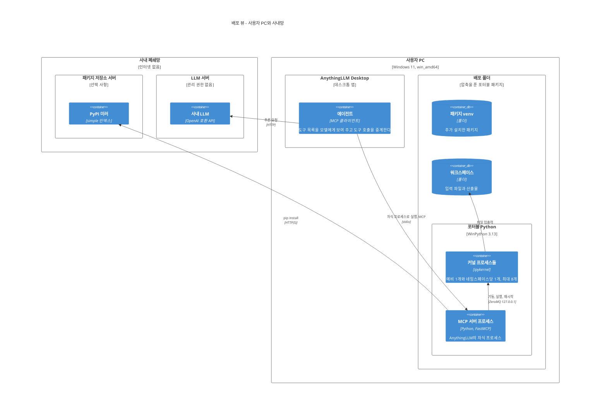
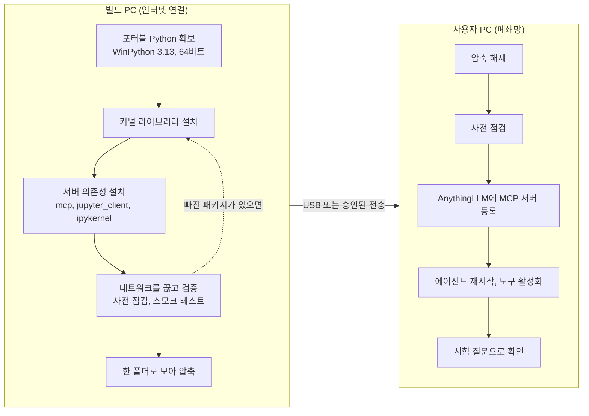

# 3-3. 배포 뷰 (Deployment View)

배포 뷰는 소프트웨어가 어디에서 도는지를 다룬다. 이 시스템에서는 배포가 유난히 중요하다. 인터넷이 없는 PC에 무언가를 "설치"하는 일이 곧 이 프로젝트의 절반이기 때문이다.

이 문서는 두 장면으로 나뉜다. 사용자 PC 안에서 프로세스와 폴더가 자리 잡은 모습(런타임 배치), 그리고 인터넷이 되는 빌드 PC에서 패키지를 만들어 폐쇄망 PC로 옮겨 오는 과정(빌드와 반입)이다. 이어서 설정, 보안 경계, 배포 이후의 운영 절차를 다룬다.

## 1. 배포 환경

| 환경 | 네트워크 | 역할 |
|---|---|---|
| 빌드 PC | 인터넷 연결됨 | 포터블 Python에 라이브러리를 설치하고 검증해 배포 패키지를 만든다 |
| 사용자 PC(대상 호스트) | 사내망만 | AnythingLLM과 샌드박스가 실제로 도는 곳. Windows 11, 64비트 |
| 사내 LLM 서버 | 사내망 | 원격 LLM. 관리 권한 없음 |
| 사내 PyPI 미러 | 사내망 | 선택 사항. 있으면 런타임 추가 설치에 쓴다(v0.6.0부터) |

빌드 PC와 사용자 PC는 네트워크로 이어져 있지 않다. 둘 사이는 USB나 승인된 파일 전송 같은 물리적·절차적 경로로만 연결된다.

## 2. 런타임 배치

### 2.1 C4 배포 다이어그램



### 2.2 프로세스 구성

사용자 PC 안에서 프로세스들은 다음과 같은 부모 자식 관계를 이룬다.

```
AnythingLLM
 └─ python.exe  (MCP 서버, stdio로 연결)
     ├─ python.exe -m ipykernel_launcher  (예비 커널)
     ├─ python.exe -m ipykernel_launcher  (ns-3fa1)
     ├─ python.exe -m ipykernel_launcher  (ns-9c07)
     │   ...                               (활성 커널 최대 8개)
     └─ python.exe -m pip install ...      (설치할 때만, venv의 python)
```

AnythingLLM은 설정 파일의 `command`와 `args`로 서버를 띄운다. 서버는 AnythingLLM의 자식이므로 AnythingLLM을 끄면 함께 꺼지고, 꺼질 때 자기가 띄운 커널을 모두 정리한다. 커널을 띄울 실행 파일은 `SANDBOX_KERNEL_PYTHON`이 정하며, 배포 패키지에서는 서버와 같은 WinPython이다.

한 시점에 떠 있을 수 있는 Python 프로세스는 서버 1개, 활성 커널 최대 8개, 예비 커널 1개, 그리고 설치 중이라면 pip 1개다.

### 2.3 메모리를 가늠하는 법

이 시스템의 메모리 사용량은 거의 전부 커널에서 나온다. 커널 하나는 빈 상태로도 수십 MB를 쓰고, 여기에 그 대화가 불러 온 데이터가 더해진다. 같은 500MB 엑셀을 세 대화가 각자 열면 세 배가 든다. 격리의 대가다.

이를 제어하는 손잡이가 둘 있다. 동시에 살아 있는 네임스페이스의 상한(`SANDBOX_MAX_NAMESPACES`, 기본 8)과 유휴 회수 시간(`SANDBOX_NS_IDLE_TIMEOUT`, 기본 1800초)이다. 메모리가 빠듯한 PC라면 상한을 낮추고 회수 시간을 줄이면 된다. 대신 회수된 대화는 데이터를 다시 불러와야 한다.

### 2.4 네트워크 연결

사용자 PC에서 밖으로 나가는 연결은 두 가지뿐이다.

- AnythingLLM에서 사내 LLM 서버로 가는 추론 요청
- pip에서 사내 미러로 가는 요청(설치할 때만)

샌드박스는 들어오는 연결을 받기 위한 포트를 열지 않는다. MCP는 stdio로, 커널 통신은 127.0.0.1 루프백으로 이루어진다.

## 3. 배포 패키지의 구조

```
AirGappedPySandbox\                 압축을 푼 위치 (이하 <BASE>)
├─ PACKAGE_INFO.txt                 패키지 개요와 빠른 시작
├─ BUILD_PORTABLE_PACKAGE.md        빌드 매뉴얼
├─ WPy64-313130\                    포터블 Python (WinPython 3.13, 모든 라이브러리 포함)
│   └─ python\python.exe            실제 인터프리터
└─ mcp-server\                      서버 코드와 부속 파일
    ├─ (서버 모듈, 사전 점검 도구, 스모크 테스트)
    ├─ requirements-server.txt      서버 의존성 목록 (3개)
    ├─ requirements-kernel.txt      커널 라이브러리 목록
    ├─ anythingllm_mcp_config.example.json
    ├─ install_offline.ps1          오프라인 휠 설치 스크립트
    ├─ start_server.ps1             수동 실행용 스크립트
    ├─ offline_wheels\              서버 의존성 휠 69개 (Python 3.11~3.13)
    ├─ workspace\                   입출력 폴더
    └─ .sandbox-venv\               추가 설치용 venv (서버 첫 기동 때 생성)
```

압축 파일 전체 크기는 약 3.47GB이고 대부분이 `WPy64-313130` 폴더다. 소스 저장소에는 WinPython 폴더, 휠, 압축 파일이 들어 있지 않다. 용량 때문에 버전 관리에서 제외하고 빌드할 때마다 만든다.

## 4. 빌드와 반입

### 4.1 전체 흐름



### 4.2 빌드 PC에서

**플랫폼을 맞춘다.** 빌드 PC의 운영체제, 비트 수, Python 마이너 버전이 사용자 PC와 같아야 한다. numpy나 PyMuPDF처럼 컴파일된 패키지는 플랫폼마다 바이너리가 다르다. 맞지 않으면 사용자 PC에서 "지원하지 않는 휠" 오류가 난다.

**두 목록을 설치한다.** 커널 라이브러리 목록에는 데이터 스택 약 30종과 ipykernel이, 서버 의존성 목록에는 mcp(1.x), jupyter_client, ipykernel이 있다. 같은 포터블 Python 하나에 둘 다 설치하면 서버와 커널이 같은 인터프리터를 쓰게 되어 설정할 것이 줄어든다.

**네트워크를 끊고 검증한다.** 폐쇄망에서 일어날 일을 미리 보려면 폐쇄망과 같은 조건에서 시험해야 한다. 사전 점검 도구는 필수·권장 패키지가 모두 있는지 확인하고, 실제로 커널을 하나 띄워 코드를 실행해 본다. 결과가 `RESULT: PASS`여야 한다. 필수 패키지가 빠졌다고 나오면(MISS) 반드시 빌드 PC에서 해결한다. 미러가 없는 사용자 PC에서는 고칠 방법이 없다.

**깨끗하게 묶는다.** 워크스페이스 안의 임시 파일, `__pycache__`, 개발용 가상환경은 압축에 넣지 않는다.

### 4.3 사용자 PC에서

압축을 풀고, 사전 점검 도구를 한 번 더 실행해 `RESULT: PASS`를 확인한 뒤, AnythingLLM의 MCP 설정에 서버를 등록한다(5.1절). 에이전트를 재시작하고 워크스페이스의 에이전트 스킬에서 도구를 켠다. 마지막으로 "x·sin(x)를 0부터 π까지 정적분하고 그래프를 저장해 줘" 같은 질문을 던져, 숫자 답과 차트 링크가 함께 돌아오는지 본다.

### 4.4 가벼운 반입

사용자 PC에 이미 라이브러리가 갖춰진 포터블 Python이 있다면, 3.47GB를 다시 옮길 필요 없이 서버 코드와 오프라인 휠만 반입할 수 있다. 설치 스크립트가 `pip install --no-index --find-links offline_wheels`로 서버 의존성을 넣는다. 휠은 Python 3.11, 3.12, 3.13용이 모두 들어 있어서 대상 Python의 마이너 버전에 맞는 것이 자동으로 골라진다. 대상 Python이 완전히 고정되어 있어 아무것도 설치할 수 없다면, 서버는 다른 Python으로 돌리고 `SANDBOX_KERNEL_PYTHON`만 그 포터블 Python을 가리키게 하면 된다([ADR-003](../adr/adr-003-separate-interpreters.md)).

## 5. 설정

### 5.1 AnythingLLM 등록

AnythingLLM의 MCP 서버 설정(Settings → Agent Skills → MCP Servers, 또는 AnythingLLM의 plugins 폴더에 있는 MCP 서버 JSON 파일)에 다음과 같이 적는다. `<BASE>`는 압축을 푼 실제 경로로 바꾼다.

```jsonc
{
  "mcpServers": {
    "air-gapped-python-sandbox": {
      "command": "<BASE>\\WPy64-313130\\python\\python.exe",
      "args": ["<BASE>\\mcp-server\\server.py"],
      "env": {
        "SANDBOX_KERNEL_PYTHON": "<BASE>\\WPy64-313130\\python\\python.exe",
        "SANDBOX_WORKSPACE": "<BASE>\\mcp-server\\workspace",
        "SANDBOX_EXEC_TIMEOUT": "45",
        "SANDBOX_PIP_INDEX_URL": "http://pypi-mirror.example.local/simple",
        "SANDBOX_PIP_TRUSTED_HOST": "pypi-mirror.example.local"
      }
    }
  }
}
```

미러가 없는 환경이라면 마지막 두 줄은 빼도 된다. 그러면 설치 도구는 항상 "미러가 설정되지 않았다"는 이유로 실패하고, 나머지 기능은 그대로 동작한다.

> v0.7.0 직후까지 저장소의 설정 예시와 수동 실행 스크립트에는 `SANDBOX_EXEC_TIMEOUT`이 옛 값 `60`으로 적혀 있었다(2026-09-24에 45로 수정). 예전 예시를 복사해 설정한 PC가 있다면 이 값을 45 이하로 바꾸자. 이유는 5.3절에 있다.

### 5.2 환경 변수

모든 설정은 환경 변수로 바꿀 수 있고, 적지 않으면 기본값을 쓴다.

**경로**

| 변수 | 기본값 | 뜻 |
|---|---|---|
| `SANDBOX_KERNEL_PYTHON` | 서버 자신의 Python | 커널을 띄울 인터프리터 |
| `SANDBOX_WORKSPACE` | 서버 폴더의 `workspace` | 입출력 폴더이자 커널의 작업 디렉터리 |
| `SANDBOX_VENV` | 서버 폴더의 `.sandbox-venv` | 추가 설치 패키지가 들어가는 venv. 워크스페이스 안에 두면 안 된다 |

상대 경로로 준 값은 서버 코드가 있는 폴더를 기준으로 해석한다. AnythingLLM이 서버를 어느 작업 디렉터리에서 띄우든 같은 폴더를 가리키게 하려는 것이다.

**시간**

| 변수 | 기본값 | 뜻 |
|---|---|---|
| `SANDBOX_TOOL_BUDGET` | 45초 | 도구 호출 하나가 응답을 미룰 수 있는 최대 시간 |
| `SANDBOX_EXEC_TIMEOUT` | 45초 | 코드 실행 한 번의 제한시간 |
| `SANDBOX_STARTUP_TIMEOUT` | 60초 | 커널 부팅을 기다리는 시간 |
| `SANDBOX_NS_IDLE_TIMEOUT` | 1800초 | 이 시간 동안 쓰지 않은 네임스페이스는 회수 |
| `SANDBOX_PIP_TIMEOUT` | 300초 | 설치 한 번의 상한 |
| `SANDBOX_PIP_NETWORK_TIMEOUT` | 15초 | pip이 인덱스 응답을 기다리는 시간 |
| `SANDBOX_VENV_CREATE_TIMEOUT` | 180초 | venv 생성 상한 |

**크기와 개수**

| 변수 | 기본값 | 뜻 |
|---|---|---|
| `SANDBOX_MAX_STREAM_CHARS` | 20000 | 돌려주는 stdout, stderr 각각의 최대 글자 수(0이면 무제한) |
| `SANDBOX_MAX_WRITE_BYTES` | 1048576 | 저장 도구 한 번에 쓸 수 있는 최대 바이트(0이면 무제한) |
| `SANDBOX_MAX_NAMESPACES` | 8 | 동시에 살아 있는 네임스페이스 커널 수 |
| `SANDBOX_MAX_PACKAGES_PER_CALL` | 20 | 설치 한 번에 요청할 수 있는 패키지 수 |
| `SANDBOX_PIP_RETRIES` | 0 | pip 재시도 횟수 |

**동작**

| 변수 | 기본값 | 뜻 |
|---|---|---|
| `SANDBOX_LAZY_START` | 미설정 | 참이면 기동 시 예비 커널과 venv를 미리 준비하지 않는다 |
| `SANDBOX_PIP_INDEX_URL` | 미설정 | 사내 미러 주소. 새 PC에서 가장 자주 빠뜨리는 값 |
| `SANDBOX_PIP_TRUSTED_HOST` | 미설정 | 미러가 평문 http일 때 그 호스트 이름 |

### 5.3 시간 값 사이의 관계

시간 관련 값은 따로 놀면 안 된다. 다음 관계가 지켜져야 한다.

```
코드 실행 제한 (EXEC_TIMEOUT 45초)
  ≤ 도구 예산 (TOOL_BUDGET 45초)
  < 클라이언트 요청 제한 (60초)
```

코드 실행이 제한시간에 걸리면 인터럽트 후 5초를 더 기다리고, 그래도 안 되면 커널을 재시작한다. 여기에 스냅샷과 프로브 시간이 붙는다. 45초 제한이면 최악의 경우에도 클라이언트의 60초 안에 서버가 쓴 `TIMEOUT` 판정이 도착한다. 실행 제한을 60초로 두면 서버의 판정과 클라이언트의 취소 중 어느 쪽이 먼저 올지 운에 맡기게 된다. 더 긴 실행이 필요하다면 세 값을 함께, 클라이언트 쪽 제한까지 올려야 한다([ADR-021](../adr/adr-021-tool-time-budget.md)).

## 6. 보안 경계

이 샌드박스는 관습 수준의 샌드박스다. 강화된 감옥이 아니다. 배포할 때 이 경계를 정확히 알아 두어야 한다.

| 무엇이 | 막히나 | 설명 |
|---|---|---|
| 파일 도구(저장, 스크립트 실행)가 워크스페이스 밖을 건드리는 것 | 막힌다 | 경로 검증기가 거절한다 |
| 모델이 쓴 코드가 워크스페이스 밖 파일을 읽고 쓰는 것 | 막히지 않는다 | 코드는 사용자 계정 권한으로 돈다. 워크스페이스 사용은 규칙으로 안내할 뿐이다 |
| 코드가 사내망에 접속하는 것 | 막히지 않는다 | "네트워크 호출 금지"는 도구 설명문의 규칙일 뿐 강제되지 않는다 |
| 코드가 인터넷으로 데이터를 내보내는 것 | 막힌다 | 서버가 막는 것이 아니라 폐쇄망 자체가 막는다 |
| 무한 루프나 멈춘 코드가 시스템을 붙잡는 것 | 막힌다 | 실행 제한, 인터럽트, 재시작 |
| 출력 폭주가 모델 컨텍스트를 채우는 것 | 막힌다 | 출력 글자 수 상한 |

더 강한 격리가 필요하다면 서버 전체를 권한이 제한된 별도 OS 계정이나 컨테이너 안에서 돌려야 한다. 둘 다 관리자 권한이 필요하므로 이 프로젝트의 전제에서는 쓰지 못했다([ADR-008](../adr/adr-008-conventional-sandbox-timeouts.md)).

## 7. 배포 이후의 운영

| 상황 | 할 일 |
|---|---|
| 기본 스택에 없는 라이브러리가 필요하다 | 미러가 있으면 모델이 설치 도구로 설치한다. 없거나, 모든 사용자에게 기본으로 필요하다면 빌드 PC에서 목록에 추가해 다시 패키징한다 |
| 추가 설치한 패키지를 모두 되돌리고 싶다 | 서버를 끄고 venv 폴더를 지운다. 다음 기동 때 빈 venv가 다시 만들어진다 |
| 서버 코드만 새 버전으로 바꾼다 | 서버 의존성이 그대로라면 `mcp-server` 폴더의 코드만 교체한다. 포터블 Python은 그대로 둔다 |
| 지금 도는 버전을 알고 싶다 | MCP 연결 시 서버가 알리는 버전(serverInfo)이나 README의 버전 이력을 본다 |
| 로그에 "TCP without encryption" 경고가 보인다 | 루프백 통신에 대한 경고이므로 무시한다 |
| 새 PC에 배포했다 | 사전 점검 도구를 실행한다. 미러를 쓸 예정이면 점검 결과에 나오는 "실제로 쓰일 인덱스"와 "도달 가능 여부"를 반드시 확인한다 |

## 생각해 볼 문제

1. 대화 하나가 평균 400MB의 데이터를 불러온다고 하자. 기본 설정에서 최악의 메모리 사용량은 얼마인가? 16GB PC라면 설정을 어떻게 바꾸겠는가?
2. 서버 코드만 바꾸는 업그레이드와 포터블 Python까지 바꾸는 업그레이드를 가르는 기준은 무엇인가? 어떤 변경이 들어오면 후자가 필요해지는가?
3. 미러가 생긴 뒤에도 필수 패키지는 포터블 Python에 넣어 두기로 했다. 모든 패키지를 미러에서 받게 하면 무엇이 위험한가?
4. 6절의 표에서 "막히지 않는다"로 남은 항목 가운데, 관리자 권한 없이도 조금이라도 좁힐 수 있는 것이 있을까?
