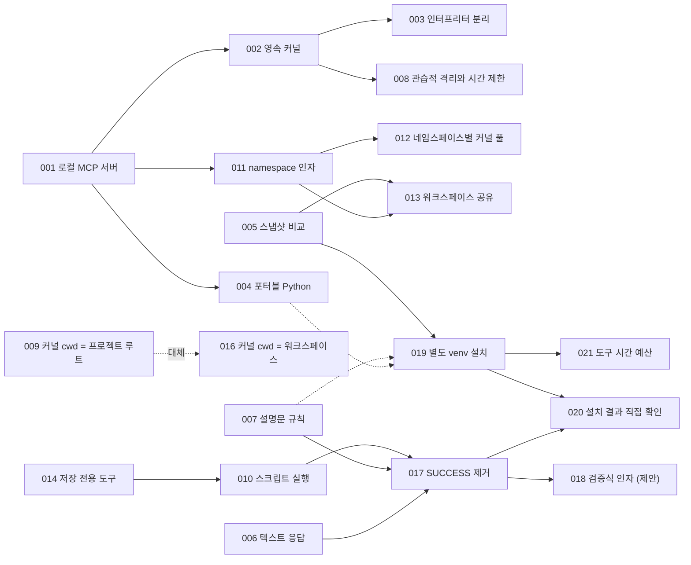

# 아키텍처 결정 기록 (ADR)

## ADR이란

ADR(Architecture Decision Record)은 설계 결정 하나를 짧은 문서 하나로 남기는 방법이다. Michael Nygard가 제안한 형식이 널리 쓰이며, 이 자료도 그 형식을 따른다.

- **상태 (Status)**: 이 결정이 지금 유효한가
- **맥락 (Context)**: 결정을 내려야 했던 상황, 제약, 검토한 선택지
- **결정 (Decision)**: 무엇을 하기로 했나
- **결과 (Consequences)**: 그 결과 좋아진 점과 치른 비용, 그리고 이후에 생긴 일

코드는 "무엇을" 했는지 보여 주지만 "왜" 그렇게 했는지, "무엇을 포기했는지"는 보여 주지 않는다. 반년 뒤 누군가 "이거 왜 이렇게 복잡하게 했지? 단순하게 바꾸자"고 할 때 ADR이 답이 된다. 이 프로젝트에도 그런 예가 있다. 워크스페이스를 대화 사이에 공유하기로 한 결정([ADR-013](adr-013-shared-workspace.md))은 "사용자가 확인한 결정이니 새 요청 없이 다시 열지 말 것"이라는 메모와 함께 기록되었다. 다음 작업자가 같은 논의를 처음부터 되풀이하지 않게 하려는 것이다.

## 상태 값

| 상태 | 뜻 |
|---|---|
| 제안됨 (Proposed) | 설계는 되었지만 아직 반영되지 않았다 |
| 채택됨 (Accepted) | 현재 시스템에 반영되어 있다 |
| 대체됨 (Superseded) | 다른 결정으로 바뀌었다. 어느 ADR로 바뀌었는지 적는다 |
| 폐기됨 (Deprecated) | 더는 유효하지 않지만 대신하는 결정은 없다 |

ADR은 고쳐 쓰지 않고 쌓아 간다. 결정이 바뀌면 새 ADR을 쓰고, 옛 ADR은 상태만 "대체됨"으로 바꾼다. 결정이 바뀐 이유 자체가 귀중한 기록이기 때문이다. [ADR-009](adr-009-kernel-cwd-project-root.md)와 [ADR-016](adr-016-kernel-cwd-workspace.md)이 그 예다. 결정의 일부만 바뀐 경우는 "채택됨"을 유지하되 어느 ADR이 무엇을 보완했는지 적었다.

## 이 기록에 대해

이 ADR들은 결정 당시에 쓴 것이 아니다. 커밋 메시지, 위키, 사용자 문서에 남은 흔적을 모아 사후에 복원했다. 날짜는 해당 커밋의 날짜다. 기록이 짧아 맥락 일부를 코드 구조에서 추론한 경우는 본문에 그렇다고 밝혔다([ADR-015](adr-015-pin-mcp-sdk-1x.md)). 결정 시점에 ADR을 쓰지 않으면 어떤 정보가 사라지는지 보여 주는 사례이기도 하다.

## 목록

| 번호 | 제목 | 상태 | 시점 |
|---|---|---|---|
| [ADR-001](adr-001-local-mcp-server.md) | 로컬 PC에 MCP 서버를 두어 사내 LLM에 코드 실행 능력을 붙인다 | 채택됨 | 2026-07-23, v0.1.0 |
| [ADR-002](adr-002-persistent-jupyter-kernel.md) | 호출마다 새 프로세스를 띄우는 대신 영속 Jupyter 커널로 상태를 유지한다 | 채택됨 | 2026-07-23, v0.1.0 |
| [ADR-003](adr-003-separate-interpreters.md) | 서버 인터프리터와 커널 인터프리터를 분리한다 | 채택됨 | 2026-07-23, v0.1.0 |
| [ADR-004](adr-004-portable-python-bundle.md) | 실행 환경 전체를 포터블 Python 하나로 묶어 반입한다 | 채택됨(ADR-019가 보완) | 2026-07-23, v0.1.0 |
| [ADR-005](adr-005-snapshot-diff-artifacts.md) | 산출물은 실행 전후 스냅샷을 비교해 찾는다 | 채택됨 | 2026-07-23, v0.1.0 |
| [ADR-006](adr-006-single-text-response.md) | 도구 응답은 하나의 텍스트 블록으로 돌려준다 | 채택됨 | 2026-07-23, v0.1.0 |
| [ADR-007](adr-007-rules-in-tool-descriptions.md) | 사용 규칙은 도구 설명문에 심는다 | 채택됨 | 2026-07-23, v0.1.0 |
| [ADR-008](adr-008-conventional-sandbox-timeouts.md) | 격리는 관습 수준으로 두고, 시간 제한과 강제 재시작으로 가용성을 지킨다 | 채택됨 | 2026-07-23, v0.1.0 |
| [ADR-009](adr-009-kernel-cwd-project-root.md) | 커널을 프로젝트 루트에서 실행하고 코드는 `./workspace/` 경로를 쓴다 | 대체됨(ADR-016) | 2026-07-23, v0.1.0 |
| [ADR-010](adr-010-run-script-file.md) | 스크립트 실행은 `__main__` 의미론을 따르되 결과를 커널에 남긴다 | 채택됨 | 2026-07-23, v0.2.0 (v0.5.0 개정) |
| [ADR-011](adr-011-namespace-argument.md) | 대화 구분은 필수 `namespace` 인자와 서버 발급 id로 한다 | 채택됨 | 2026-07-25, v0.3.0 |
| [ADR-012](adr-012-kernel-pool-per-namespace.md) | 네임스페이스마다 커널 하나를 두고 풀로 관리한다 | 채택됨 | 2026-07-25, v0.3.0 |
| [ADR-013](adr-013-shared-workspace.md) | 워크스페이스 파일은 네임스페이스 사이에 공유한다 | 채택됨 | 2026-07-25, v0.3.0 |
| [ADR-014](adr-014-write-file-tool.md) | 코드를 실행하지 않는 파일 저장 전용 도구를 둔다 | 채택됨 | 2026-08-04, v0.4.0 |
| [ADR-015](adr-015-pin-mcp-sdk-1x.md) | MCP Python SDK를 1.x 대에 고정한다 | 채택됨 | 2026-08-26 |
| [ADR-016](adr-016-kernel-cwd-workspace.md) | 커널을 워크스페이스 안에서 실행한다 | 채택됨 | 2026-08-28, v0.4.1 |
| [ADR-017](adr-017-execution-verdict.md) | 실행 판정에서 `SUCCESS`를 없앤다 | 채택됨 | 2026-09-22, v0.5.0 |
| [ADR-018](adr-018-expect-verification.md) | 검증식 인자로 "검증된 성공"을 판정한다 | 제안됨 | 2026-09-22 |
| [ADR-019](adr-019-side-venv-installs.md) | 패키지 설치를 허용하되 별도 venv에 격리한다 | 채택됨 | 2026-09-22, v0.6.0 |
| [ADR-020](adr-020-verify-installs-directly.md) | 설치 결과는 pip 출력이 아니라 커널과 인덱스에 직접 확인한다 | 채택됨 | 2026-09-22, v0.6.0 |
| [ADR-021](adr-021-tool-time-budget.md) | 모든 도구 호출은 클라이언트 제한시간보다 먼저 응답한다 | 채택됨 | 2026-09-22, v0.7.0 |

## 결정 사이의 관계

실선 화살표는 "앞 결정이 뒤 결정의 맥락이 되었다"는 뜻이다. 점선은 뒤 결정이 앞 결정을 대체하거나(009 → 016) 일부 보완·개정한 관계다(004, 007 → 019).

## 읽는 순서 추천

- **처음 읽는다면**: 001 → 002 → 004 → 011 → 017. 시스템의 뼈대와 가장 큰 교훈이 담겨 있다.
- **장애를 다룬다면**: 008 → 016 → 020 → 021. 실제 운영에서 부딪힌 문제들이다.
- **LLM용 도구 설계에 관심이 있다면**: 007 → 014 → 017 → 018. 4장과 함께 읽으면 좋다.
- **ADR 작성법 자체를 배운다면**: 009와 016(대체 관계), 015(근거가 희박한 기록), 018(제안 상태)을 비교해 보자.
