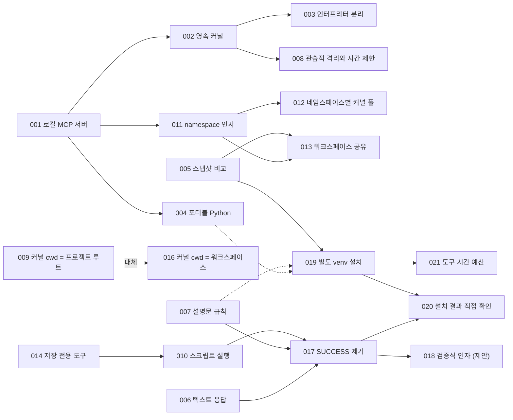

# 아키텍처 결정 기록 (ADR)

## ADR이란 무엇인가요?

ADR(Architecture Decision Record)은 소프트웨어 아키텍처의 중요한 의사결정 하나를 단일 문서로 압축하여 남기는 체계적인 엔지니어링 문서화 기법입니다. Michael Nygard가 제안한 표준 형식이 업계에서 널리 쓰이며, 본 자료 역시 그 형식을 충실히 따르고 있습니다.

- **상태 (Status)**: 이 아키텍처 결정이 현재 시점에서 유효한지 여부를 명시합니다.
- **맥락 (Context)**: 결정을 내려야만 했던 당시의 기술적 상황, 제약 조건, 그리고 비교 검토했던 여러 선택지들을 기술합니다.
- **결정 (Decision)**: 최종적으로 어떤 해결책을 채택하기로 결정했는지 명확히 선언합니다.
- **결과 (Consequences)**: 그 결정을 통해 얻게 된 실질적인 이점과 감수해야 했던 트레이드오프(비용), 그리고 이후 시스템에 발생한 파급 효과를 객관적으로 기록합니다.

소스코드는 시스템이 "무엇을" 구현했는지는 명확히 보여주지만, "왜" 그렇게 설계했는지, 그리고 당시 "어떤 대안들을 포기했는지"는 결코 보여주지 못합니다. 반년 뒤 새로운 개발자가 합류하여 "이 기능은 왜 이렇게 번거롭게 구현되어 있지? 그냥 단순하게 바꾸자"라고 의문을 제기할 때, 당시의 치열했던 고민과 불가피했던 현실을 설명해 주는 가장 든든한 나침반이 바로 ADR입니다. 본 프로젝트에도 그러한 대표적인 사례가 있습니다. 워크스페이스 디렉터리를 모든 대화 세션 간에 공유하기로 한 결정([ADR-013](adr-013-shared-workspace.md))은 "사용자 실무진과 직접 협의하여 최종 확정한 결정이므로, 새로운 공식 요구사항이 없는 한 논의를 다시 번복하여 열지 말 것"이라는 단호한 주의 메모와 함께 기록되어 있습니다. 후속 작업자가 과거에 이미 결론이 난 논의를 처음부터 헛되이 되풀이하지 않도록 방어해 주는 역할을 합니다.

## ADR 상태 값의 정의

| 상태 명칭 | 상태의 정확한 의미 |
|---|---|
| 제안됨 (Proposed) | 설계와 검토는 완료되었으나, 아직 실제 프로덕션 시스템 코드에 반영되지는 않은 상태입니다. |
| 채택됨 (Accepted) | 현재 릴리스된 시스템에 공식적으로 반영되어 실질적으로 유효하게 동작하고 있는 결정입니다. |
| 대체됨 (Superseded) | 후속 요구사항이나 환경 변화로 인해 새로운 결정으로 대체된 상태입니다. 어떤 후속 ADR로 대체되었는지 명시합니다. |
| 폐기됨 (Deprecated) | 더 이상 시스템에서 유효하지 않으나, 이를 직접 대신하는 대체 결정은 존재하지 않는 상태입니다. |

ADR 문서는 기존 내용을 함부로 수정하여 덮어쓰지 않고, 시간 순서에 따라 차곡차곡 누적해 나가는 것이 대원칙입니다. 만약 과거의 의사결정이 번복되거나 변경되면 새로운 ADR 문서를 작성하고, 과거의 ADR 문서는 상태 필드만을 "대체됨"으로 업데이트합니다. 의사결정이 변경된 이유와 배경 그 자체가 프로젝트의 매우 귀중한 역사적 자산이기 때문입니다. [ADR-009](adr-009-kernel-cwd-project-root.md)와 [ADR-016](adr-016-kernel-cwd-workspace.md)이 바로 이러한 대체 관계의 대표적인 예시입니다. 한편 기존 결정의 기본 골격은 유지하면서 세부 규칙 일부만을 보완·개정한 경우에는 "채택됨" 상태를 유지하되, 어느 후속 ADR이 구체적으로 무엇을 보완했는지를 상호 참조로 명확히 명기했습니다.

## 본 아키텍처 결정 기록에 대하여

본 디렉터리에 수록된 ADR 문서들은 시스템 개발 당시에 실시간으로 작성된 문서가 아닙니다. 프로젝트의 Git 커밋 메시지, 내부 기술 위키, 사용자 배포 매뉴얼 등에 흩어져 있던 의사결정의 흔적들을 면밀히 추적하여 사후에 체계적으로 복원한 기록입니다. 각 문서에 명시된 일자는 해당 기능이 최초로 반영된 실제 커밋 일자입니다. 과거 기록이 다소 짧아 당시의 맥락 일부를 소스코드 구조로부터 역추론하여 복원한 경우에는 본문 내에 그 사실을 솔직하게 밝혀 두었습니다([ADR-015](adr-015-pin-mcp-sdk-1x.md)). 이는 의사결정 시점에 ADR을 제때 기록해 두지 않으면 훗날 얼마나 귀중한 맥락 정보들이 유실되는지를 역설적으로 보여주는 생생한 교육적 반면교사이기도 합니다.

## 전체 ADR 목록

| 번호 | 아키텍처 결정 제목 | 상태 | 반영 시점 및 버전 |
|---|---|---|---|
| [ADR-001](adr-001-local-mcp-server.md) | 로컬 PC에 MCP 서버를 두어 사내 LLM에 코드 실행 능력을 부여합니다 | 채택됨 | 2026-07-23, v0.1.0 |
| [ADR-002](adr-002-persistent-jupyter-kernel.md) | 호출마다 새 프로세스를 띄우는 대신 영속 Jupyter 커널로 상태를 유지합니다 | 채택됨 | 2026-07-23, v0.1.0 |
| [ADR-003](adr-003-separate-interpreters.md) | 서버 인터프리터와 커널 인터프리터를 아키텍처적으로 분리합니다 | 채택됨 | 2026-07-23, v0.1.0 |
| [ADR-004](adr-004-portable-python-bundle.md) | 실행 환경 전체를 독립된 포터블 Python 하나로 묶어 오프라인 반입합니다 | 채택됨 (ADR-019가 보완) | 2026-07-23, v0.1.0 |
| [ADR-005](adr-005-snapshot-diff-artifacts.md) | 산출물 파일은 코드 실행 전후의 파일시스템 스냅샷을 비교하여 탐지합니다 | 채택됨 | 2026-07-23, v0.1.0 |
| [ADR-006](adr-006-single-text-response.md) | 도구의 모든 반환 결과는 단 하나의 일체형 텍스트 블록으로 응답합니다 | 채택됨 | 2026-07-23, v0.1.0 |
| [ADR-007](adr-007-rules-in-tool-descriptions.md) | 핵심 도구 사용 규칙을 도구 설명문(Description) 내부에 직접 주입합니다 | 채택됨 | 2026-07-23, v0.1.0 |
| [ADR-008](adr-008-conventional-sandbox-timeouts.md) | 격리는 관습 수준으로 수용하고, 엄격한 시간 제한과 강제 재시작으로 가용성을 방어합니다 | 채택됨 | 2026-07-23, v0.1.0 |
| [ADR-009](adr-009-kernel-cwd-project-root.md) | 커널을 프로젝트 루트에서 실행하고 코드는 `./workspace/` 상대 경로를 사용합니다 | 대체됨 (ADR-016으로 대체) | 2026-07-23, v0.1.0 |
| [ADR-010](adr-010-run-script-file.md) | 스크립트 실행은 `__main__` 의미론을 따르되 실행 결과를 커널 메모리에 유지합니다 | 채택됨 | 2026-07-23, v0.2.0 (v0.5.0 개정) |
| [ADR-011](adr-011-namespace-argument.md) | 대화 세션의 구분은 필수 `namespace` 인자와 서버가 발급한 고유 ID를 사용합니다 | 채택됨 | 2026-07-25, v0.3.0 |
| [ADR-012](adr-012-kernel-pool-per-namespace.md) | 네임스페이스마다 독립 커널을 배정하고 상시대기 예비 커널 풀로 관리합니다 | 채택됨 | 2026-07-25, v0.3.0 |
| [ADR-013](adr-013-shared-workspace.md) | 워크스페이스 디스크 디렉터리는 모든 네임스페이스 세션 간에 공유합니다 | 채택됨 | 2026-07-25, v0.3.0 |
| [ADR-014](adr-014-write-file-tool.md) | 코드를 직접 실행하지 않는 독립적인 파일 기록 전용 도구를 분리 신설합니다 | 채택됨 | 2026-08-04, v0.4.0 |
| [ADR-015](adr-015-pin-mcp-sdk-1x.md) | MCP Python SDK 의존성을 1.x 대역에 안정적으로 고정합니다 | 채택됨 | 2026-08-26 |
| [ADR-016](adr-016-kernel-cwd-workspace.md) | Jupyter 커널의 작업 디렉터리(cwd)를 워크스페이스 내부로 일치시킵니다 | 채택됨 | 2026-08-28, v0.4.1 |
| [ADR-017](adr-017-execution-verdict.md) | 실행 판정 어휘 체계에서 모호한 `SUCCESS` 상태를 완전히 폐지합니다 | 채택됨 | 2026-09-22, v0.5.0 |
| [ADR-018](adr-018-expect-verification.md) | 검증식(`expect`) 인자를 추가하여 모델에게 객관적으로 "검증된 성공"을 요구합니다 | 제안됨 (Proposed) | 2026-09-22 |
| [ADR-019](adr-019-side-venv-installs.md) | 패키지 동적 설치를 허용하되 원본 런타임을 보호하기 위해 사이드 venv에 격리합니다 | 채택됨 | 2026-09-22, v0.6.0 |
| [ADR-020](adr-020-verify-installs-directly.md) | 패키지 설치 성공 여부는 pip 출력이 아닌 커널 내부에서 직접 검증합니다 | 채택됨 | 2026-09-22, v0.6.0 |
| [ADR-021](adr-021-tool-time-budget.md) | 모든 도구 호출은 클라이언트 타임아웃 제한 시간보다 여유 있게 먼저 응답합니다 | 채택됨 | 2026-09-22, v0.7.0 |

## 아키텍처 결정 간의 상관관계도

위 관계도에서 실선 화살표는 "선행 의사결정이 후행 결정의 직접적인 기술적 맥락(Context)이 되었다"는 인과관계를 의미합니다. 점선 화살표는 후행 결정이 선행 결정을 전면 대체하거나(009 → 016) 기존 규칙을 부분적으로 보완·수정했음(004, 007 → 019)을 나타냅니다.

## 관심사별 권장 열람 순서

- **전체 시스템의 핵심 뼈대를 파악하고자 하실 때**: 001 → 002 → 004 → 011 → 017 순으로 살펴보십시오. 본 프로젝트의 기본 아키텍처와 가장 큰 교훈이 집중되어 있습니다.
- **실무 장애 대응과 운영 트러블슈팅을 다루실 때**: 008 → 016 → 020 → 021 순으로 읽어보시기를 권합니다. 실제 폐쇄망 프로덕션 운영 중에 발생했던 치명적인 난제와 그 해법이 담겨 있습니다.
- **LLM 에이전트 연동 도구 설계 기법에 집중하고자 하실 때**: 007 → 014 → 017 → 018 순으로 열람하시기 바랍니다. 4장의 도구 설계 원칙과 함께 학습하시면 효과가 극대화됩니다.
- **ADR 문서화 기법 자체를 학습하고자 하실 때**: 009와 016(대체 관계의 기록 방식), 015(과거 맥락 추론의 한계 기술법), 018(제안 상태의 미래 로드맵 기술법)을 비교 분석해 보시기 바랍니다.
